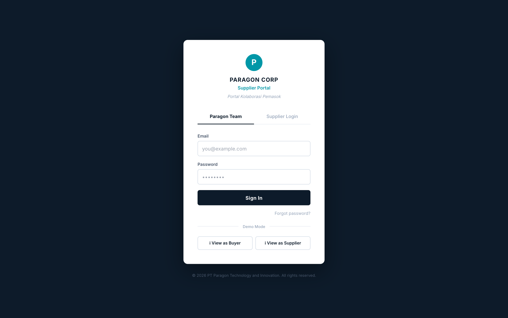
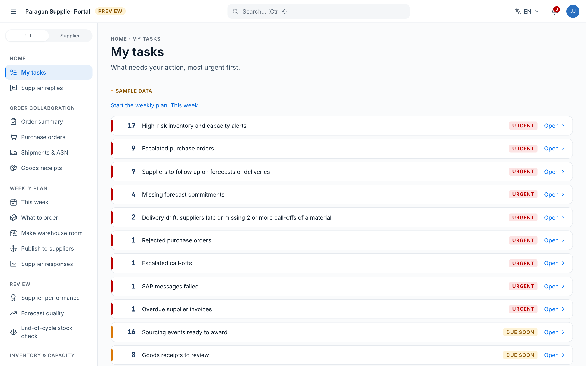
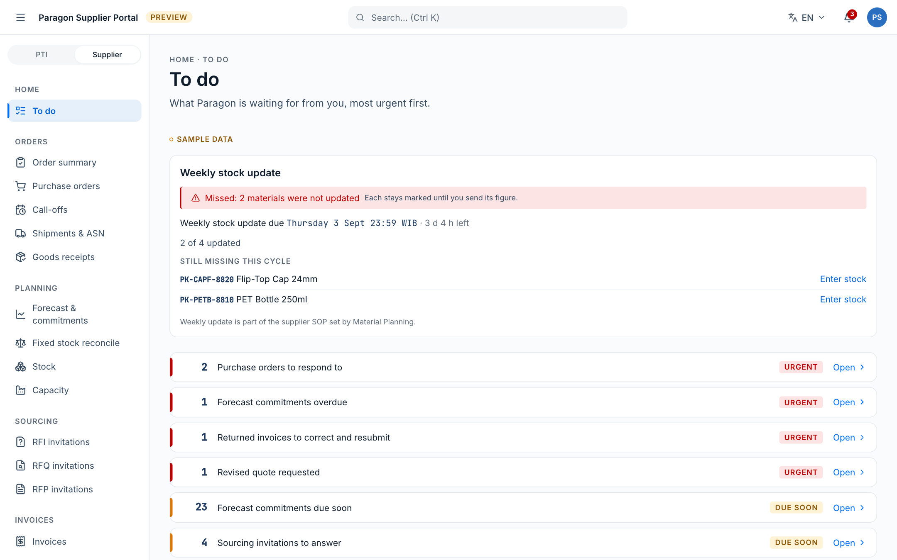
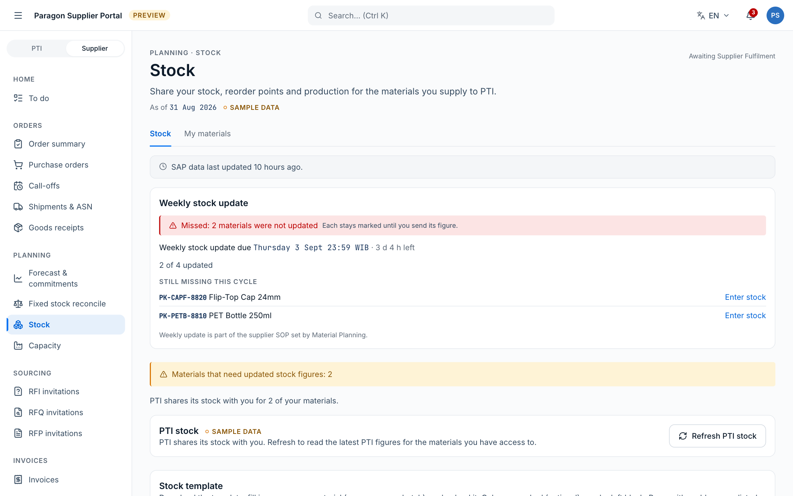
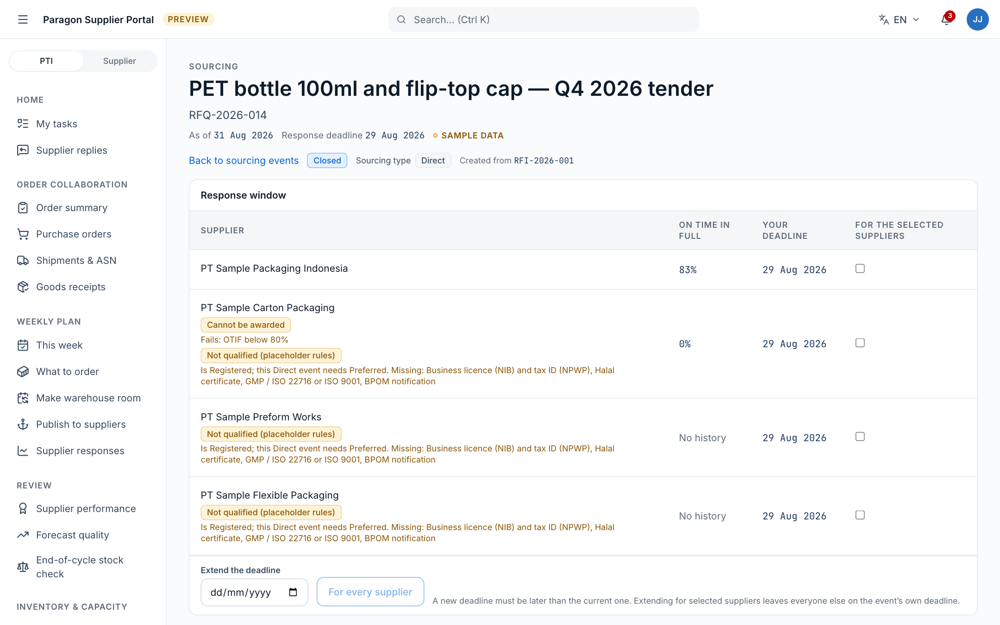
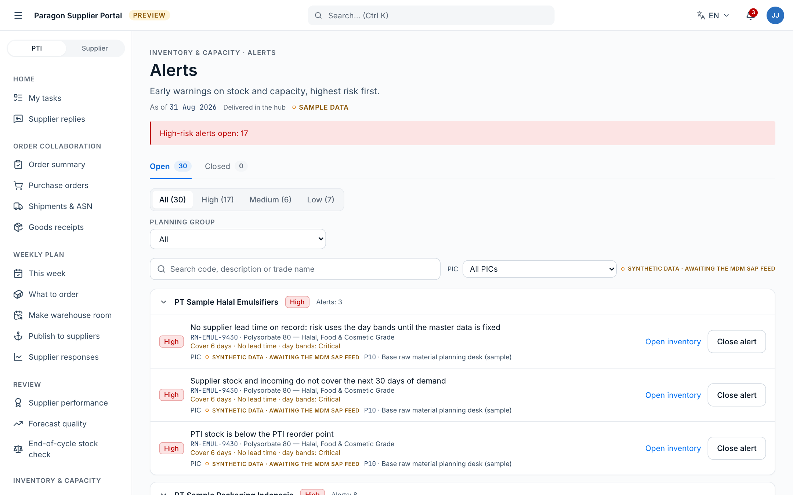
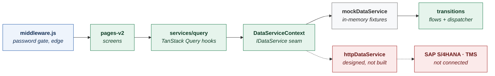

<div align="center">


# Paragon Supplier Portal

**A supplier collaboration hub that records what was asked, answered and
refused, and never claims to own an SAP document.**

The portal lets PT Paragon Technology and Innovation (PTI) and its suppliers
work one shared record — *confirm a purchase order*, *commit to a forecast
period*, *answer an RFQ*, *declare a halal certificate* — through **a state
machine per document, with every action checked against the seat's business
role before it runs**. It is a React 19 single-page app in JavaScript with
JSDoc types, served by Vercel behind a password gate.

Today it is a **prototype on sample data held in the browser**. There is no
backend, no SAP connection and no email. The hub's own rules, refusals and
calculations are real; anything a user changes is lost on reload.


[](docs/supplier-hub/SUPPLIER-HUB-PRD.md)

</div>

---

## Try it in one command

Clone, install and start the dev server on Node 24.

```bash
nvm use               # reads .nvmrc, which pins 24
npm ci
npm run dev           # Vite on http://localhost:5173
```

Open `http://localhost:5173/#/login` and choose **View as Buyer** or **View as
Supplier** under *Demo Mode*. Email and password are ignored; the buttons open
a seeded seat (`src/pages/auth/Login.jsx`).

<div align="center">



</div>

The supplier button always opens `sup-007`, *PT Sample Packaging Indonesia*.
That is a fixed demo seat, not a bug: screens for any other supplier need a
`localStorage` edit ([SCENARIOS.md §5](docs/supplier-hub/user-guide/SCENARIOS.md)).

## The hub

<div align="center">



***My tasks**, the PTI home, on the demo date 31 Aug 2026: counts of what
waits on PTI, urgent rows first, each with an **Open** link to the screen that
clears it. A planner starts the week here rather than in a menu. The screen
exists because the PTI menu has ten sections; a count per task is what stops a
planner from opening each of them to find the one that is late.*




***To do** and **Stock**, supplier side. To do lists what Paragon waits for,
missed stock updates first. Stock shows the same seat with its Fulfilment lane
removed: the save action is replaced by the text "Awaiting Supplier
Fulfilment". The portal renders who must act rather than a disabled button,
because a greyed-out control tells a user *no* without telling them *who*.*




***RFQ event** and **Alerts**. The RFQ page states, per supplier, why it
cannot be awarded — OTIF below 80%, or missing documents for a *Direct*
event — before the buyer reaches the award step. Alerts lists 30 open risks,
highest first; closing one needs a reason. Both screens show the reason next
to the row, because a refusal or a risk without its cause sends the user to
another screen to find it.*

<sub><a href="docs/supplier-hub/user-guide/screens/">34 screens in all</a>,
captured at 2160×1350 for the user guide. No capture script exists; the shots
follow the plan in
<a href="docs/supplier-hub/user-guide/SCENARIOS.md">SCENARIOS.md §5</a>.
Four honest notes: (1) the orange <i>SAMPLE DATA</i> and <i>SYNTHETIC DATA ·
AWAITING THE MDM SAP FEED</i> markers are the system working; every figure is a
fixture. (2) The bell always shows 3 and does nothing
(<code>TopBarV2.jsx</code>). (3) The search box says <kbd>Ctrl</kbd> <kbd>K</kbd>
but no handler is wired; <kbd>↑</kbd> <kbd>↓</kbd> <kbd>Enter</kbd> work once
the box has focus. (4) "Not qualified (placeholder rules)" is warn-only until
the real qualification lists arrive (BL-146). Below 1024 px the sidebar
becomes a drawer behind ☰; <kbd>Esc</kbd> closes it.</sub>

</div>

The two personas see different menus. A PTI seat's menu is also filtered by
**Menu for** (Material Planner, Buyer, Finance, All PTI roles). That filter
changes what is *shown*, never what is *allowed*: permission comes from the
seat's business roles, edited under avatar → **Roles**.

<details>
<summary><b>Every screen, by menu</b> (from
<code>src/components/layout-v2/navConfig.js</code> and
<code>src/router/AppRouter.jsx</code>)</summary>

**PTI menu**

| Section › Screen | Route | Question it answers |
|---|---|---|
| Home › My tasks | `/buyer/home` | What needs my action, most urgent first? |
| Home › Supplier replies | `/buyer/comm-hub` | Which supplier reply can I record as stock? |
| Order collaboration › Order summary | `/buyer/order-summary` | Is each order secured across its 3 confirmations? |
| Order collaboration › Purchase orders | `/buyer/orders` | Which POs did a supplier change or reject? |
| Order collaboration › Shipments & ASN | `/buyer/shipments` | What is inbound, and which shelf-life exception waits? |
| Order collaboration › Goods receipts | `/buyer/goods-receipt` | What was received, inspected and posted? |
| Weekly plan › This week | `/buyer/this-week` | What do I work on first this week? |
| Weekly plan › What to order | `/buyer/order-plan` | Which orders fit the warehouse this week? |
| Weekly plan › Make warehouse room | `/buyer/reschedule` | Which open orders move when a week is over capacity? |
| Weekly plan › Publish to suppliers | `/buyer/stabilise` | Is the plan ready to send to suppliers? |
| Weekly plan › Supplier responses | `/buyer/collaboration` | Which commitments do I accept or send back? |
| Review › Supplier performance | `/buyer/scorecard` | Which suppliers need follow-up this month? |
| Review › Forecast quality | `/buyer/demand-forecast` | Can the engine's forecast be trusted against SAP's? |
| Review › End-of-cycle stock check | `/buyer/fs-reconcile` | Did commitments, call-offs and stock balance? |
| Inventory & capacity › Inventory | `/buyer/inventory` | Where are supplier and PTI stock against reorder points? |
| Inventory & capacity › Stock simulation | `/buyer/stock-simulation` | What will a supplier hold on the check date? |
| Inventory & capacity › Capacity | `/buyer/capacity` | Does allocated capacity cover the LTP, week by week? |
| Inventory & capacity › Alerts | `/buyer/alerts` | Which stock or capacity risk is highest now? |
| Inventory & capacity › Supplier access | `/buyer/supplier-access` | Which suppliers may see PTI stock? |
| Materials › Trade names | `/buyer/materials/trade-names` | Which supplier names for PTI materials are approved? |
| Call-offs › Call-offs | `/buyer/call-offs` | Which call-offs are released, confirmed or disputed? |
| Sourcing › RFI · RFQ · RFP | `/buyer/rfi` · `/buyer/rfq` · `/buyer/rfp` | Which sourcing event needs my next step? |
| Sourcing › Suppliers | `/buyer/suppliers` | Who supplies us, and how do they perform? |
| Invoices › Invoices | `/buyer/invoices` | Which invoices match, and which can be paid? |

**Supplier menu**

| Section › Screen | Route | Question it answers |
|---|---|---|
| Home › To do | `/supplier/home` | What is Paragon waiting for from me? |
| Orders › Order summary | `/supplier/order-summary` | Where does each of my orders stand? |
| Orders › Purchase orders | `/supplier/orders` | Which POs do I acknowledge, confirm or adjust? |
| Orders › Call-offs | `/supplier/call-offs` | Which delivery do I confirm or dispatch? |
| Orders › Shipments & ASN | `/supplier/shipments` | Which shipment needs an ASN? |
| Orders › Goods receipts | `/supplier/goods-receipts` | What did PTI receive, and do I dispute it? |
| Planning › Forecast & commitments | `/supplier/forecasts` | What do I commit per period? |
| Planning › Fixed stock reconcile | `/supplier/fs-reconcile` | Did my cycle balance against max stock? |
| Planning › Stock | `/supplier/inventory` | Which stock figures are due? |
| Planning › Capacity | `/supplier/capacity` | What capacity do I give PTI for 13 weeks? |
| Sourcing › RFI · RFQ · RFP invitations | `/supplier/rfi` · `/supplier/rfq` · `/supplier/rfp` | Which request do I answer, and by when? |
| Invoices › Invoices | `/supplier/invoices` | Which invoice do I submit or correct? |
| Performance › My performance | `/supplier/performance` | How does Paragon score me? |
| Company › Profile & documents | `/supplier/documents` | Which certificate is missing or expiring? |

**Avatar → Help & administration (PTI)**: glossary (`/glossary`, both
personas), roles (`/buyer/roles`), process flows (`/buyer/process-flows`),
interface monitor, ten admin pages under `/buyer/admin/…` (working calendar,
3PL tracking, supplier stock update mode, vendor qualification, sourcing
types, planning groups, MRP controllers, tolerances, alert thresholds, reason
codes) and five *Planning engine* pages (material requirement, safety stock,
data health, model backtest, supplier reliability).

**Reachable by URL only**: `/buyer/purchase-requisition`, `/buyer/compliance`,
`/buyer/contracts`, `/buyer/delivery-agreements`, `/buyer/chase`,
`/buyer/dashboard`, `/buyer/analytics`, `/buyer/risk`, `/buyer/discovery`,
`/buyer/supplier-applications`, `/buyer/intake-review`, `/buyer/plan-grid`,
`/marketplace`, `/supplier/dashboard`, `/supplier/storefront`,
`/supplier/whatsapp`, `/supplier/comm-hub`, `/supplier/delivery-agreements`.
`/register` is the supplier onboarding wizard, out of scope here (owned by the
Foundation team).

</details>

---

## The problem

PTI plans materials in SAP S/4HANA and talks to suppliers by email, WhatsApp
and spreadsheet. A PO confirmation, a forecast commitment and a certificate
renewal each live in a different thread. Nobody can say, for one material,
who was asked what and when.

The obvious fix is a portal that copies SAP documents and lets both sides edit
them. That creates a second system of record. When the portal and S/4 disagree
on a PO, neither side knows which one is true.

***Which acts may the portal originate, and which must it only report?***

## What the portal does instead

It owns the **collaboration record** — the confirmation, the commitment, the
declared document, the refusal with its reason — and never the S/4 document.
Every act is a transition on a state machine. Each transition declares whether
a Paragon screen may ever offer it, and if not, why and which system owns the
fact. That declaration is data on the verb: the `surfaceable` field and
`ExternalFactOwner` (`'s4hana' | 'tms' | 'bank'`) in
[`src/services/transitions/schema.js`](src/services/transitions/schema.js).
Every machine, with its owner per refused act, renders at
`/buyer/process-flows`.

An ASN going *In Transit* is the clearest case. The supplier cannot press a
button for it, because TMS reports that fact. The transition exists, carries
`owner: 'tms'`, and no screen offers it
(`src/services/transitions/flows/advanceShipNotice.flow.js`).

The SE team implements against the contracts package in
[`src/services/contracts/`](src/services/contracts/) and proves conformance
with the two factories in
[`src/services/contracts/conformance/`](src/services/contracts/conformance/):
`describeDispatchConformance` (authorisation and preconditions, as a client
sees them through `dispatch`) and `describeScopingConformance` (one supplier
never reads another's rows). Both run today against the mock only.

## The idea the whole system is built on

**A refusal is a result, not an error.** The portal treats "you may not", "not
yet" and "someone else owns this" as answers to show, with their reason. Four
consequences run through the codebase.

**A missing permission names who can act.** Where a seat lacks the role for a
verb, the control is replaced by "Awaiting {owner}" with the hint "Your role
cannot take this action." Coverage is checked per surface, verb and entrance,
not per page ([`HandoffNotice.jsx`](src/components/ui-v2/HandoffNotice.jsx),
[`useVerbAvailability.js`](src/hooks/useVerbAvailability.js)).

**Simulated data says so on screen.** Every fixture-backed figure carries a
*SAMPLE DATA* or *SYNTHETIC DATA* marker, and engine-made call-off drafts are
refused release with `ENGINE_DATA_SIMULATED` while the data is simulated
([`MockCommandService.js`](src/services/data/mock/MockCommandService.js)).

**The order of refusals is fixed.** The dispatcher checks role, then
`expectedState`, then legality, then fields, scope and policy. A caller
without the role learns nothing about the document; a stale caller is told why
(`COMMAND_REFUSALS` in
[`dispatcher.js`](src/services/transitions/dispatcher.js), pinned in order by
[`staleState.test.js`](src/services/transitions/staleState.test.js)).

**Counts are derived, never written.** Docs point at the command that produces
a number rather than state it. The test floor lives in
[`scripts/floor.json`](scripts/floor.json), and `npm run gates` fails if
`CLAUDE.md` stops pointing at it.

---

## Architecture

**One React app; 394,030 lines of JS and JSX in `src/`** (counted at `a5eaac3`
with `find src -name '*.js' -o -name '*.jsx' | xargs wc -l`, tests included).
Pages never import a data source; they read through `useDataService()`.



<sub>Green: the portal's own code. Blue: Vercel edge. Grey: the in-memory
store. Red, dashed: designed and not built.</sub>

The seam sits at `DataServiceContext` because that is the one place the backend
swap can happen without touching a page: `src/main.jsx` mounts
`mockDataService`, and a future `httpDataService` is passed through the same
`service` prop ([`DataServiceContext.jsx`](src/services/data/DataServiceContext.jsx)).
The transition layer sits below the mock, not beside the pages, because a rule
enforced in a page is a rule the backend can skip. Tenant scoping is enforced
in the service layer today — client-side, which is acceptable only because
there is no real data.

| Part | Where | Why it sits there |
|---|---|---|
| Screens | [`src/pages-v2/`](src/pages-v2/) | One folder per page; large pages split into `components/` and `hooks/` |
| Shell | [`src/components/layout-v2/`](src/components/layout-v2/) | Menu, top bar, identity panel; `navConfig.js` is the one menu source |
| Shared UI | [`src/components/ui-v2/`](src/components/ui-v2/) | `Button` has no `'primary'` variant, so a solid button is a type error |
| Data seam | [`src/services/data/`](src/services/data/) | `IDataService` typedef in `types.js`; the mock in `mock/` |
| State machines | [`src/services/transitions/`](src/services/transitions/) | Flows, business roles, dispatcher, cascades |
| Forecast engine | [`src/services/engine/`](src/services/engine/) | In-house demand and material forecast, on synthetic data |
| Contracts | [`docs/contracts/`](docs/contracts/) + [`src/services/contracts/`](src/services/contracts/) | Prose contracts C1–C12, pinned to code by tests |
| Strings | [`src/lib/i18n.js`](src/lib/i18n.js) + [`src/lib/i18n/`](src/lib/i18n/) | English and Bahasa Indonesia; parity enforced by `fragments.test.js` |

### The access gate, and why it is outside `src/`

The whole site, assets included, sits behind
[`middleware.js`](middleware.js) and [`gate/`](gate/): an HMAC-SHA256 signed,
HttpOnly, 7-day session cookie, checked at the Vercel edge before the SPA
rewrite. Credentials come from `GATE_USER`, `GATE_PASSWORD` and `GATE_SECRET`,
never from a `VITE_` variable, so they are never bundled. A missing secret
fails closed with a 503. The gate lives outside `src/` so its tests
(`npm run test:gate`, `node --test`) never mix with the app suite. This gate
protects a prototype; it is **not** user sign-in. Real sign-in is BL-28.

### Why JavaScript with JSDoc, and not TypeScript

The owner ruled on 2026-10-02 that the portal matches the company React
boilerplate. Every file in `src/` is now JavaScript except `vite-env.d.ts`.
Types stayed: `tsconfig.json` sets `checkJs`, so `tsc` still type-checks every
file through JSDoc. The conversion rules are in
[`docs/frontend-standard/`](docs/frontend-standard/).

### Why HashRouter

Routes are hash-based (`#/buyer/home`) in
[`AppRouter.jsx`](src/router/AppRouter.jsx). `AppRouter` is a flat list with
no layout route, so each page brings its own shell; `allRoutes.smoke` derives
the route list from the router source, so a new route cannot go untested.

## Features and capabilities

Every bullet states the capability **and** its guarantee or its limit. Step-
by-step flows with file citations are in
[SCENARIOS.md](docs/supplier-hub/user-guide/SCENARIOS.md).

### Sourcing runs end to end, and the award stops at SAP

- **Requisition to RFQ award, with negotiation rounds.** PR → approval → RFQ
  wizard → quotes → round → award per item, including splits by % or
  quantity. *Limit:* the PO or contract is raised in S/4; the portal records
  the SAP number (**Mark raised in SAP**).
- **A compliance gate on award.** A supplier failing the OTIF minimum or the
  document set for the event's sourcing type cannot be awarded. *Limit:* the
  80% OTIF minimum and the qualification lists are placeholders (BL-55,
  BL-146).
- **RFI and RFP share the pattern.** RFP adds firm-offer rounds and an award
  that always needs a reason. *Limit:* an open RFI or RFP cannot be cancelled,
  and an RFQ never closes itself at its deadline.
- **Suppliers see only their own invitee row.** *Guarantee:* the read model
  narrows the list per supplier (`rfxReadModel.js`). Attachments: 25 MB per
  file, 30 files per response.

### Purchase order to payment follows one document

- **PO acknowledge, confirm or adjust; PTI answers the counter-offer.**
  *Guarantee:* a confirmed quantity above the ordered one is blocked
  (`policies.js`).
- **ASN against open quantity.** Over-shipping is refused
  (`OVER_OPEN_QUANTITY`) unless a reason is given; short shelf life needs a
  PTI exception. *Limit:* *In Transit* and *Delivered* come from TMS/S4, and
  no screen produces them.
- **Goods receipt in a 4-step wizard, with discrepancies the supplier can
  dispute.** *Limit:* "Submit inspection results" and "Override hold" only show
  a toast.
- **Invoice match with tolerance.** Price within 2%, capped at Rp 500,000;
  duplicates and over-invoicing are refused. *Limit:* a *Matched* invoice
  never becomes *Approved* in the UI, so only seeded approved invoices can be
  paid; the Rp cap is a placeholder (BL-54).

### Planning shares one forecast and checks it against capacity

- **Forecast commitments per period.** Firm lines allow no shortfall;
  trade-off lines accept up to 10% short. *Guarantee:* a commitment carries
  forward only when its period quantity is unchanged.
- **Capacity for 13 weeks against the LTP**, a reason required below it.
  *Limit:* whether capacity is fixed or week-to-week is undecided (BL-65).
- **Call-offs against agreements.** Up to +5% is accepted; more, or a later
  date, needs PTI approval. *Limit:* call-offs from the engine are refused
  release while data is synthetic.
- **Nine alert rules on stock, capacity, commitments and call-offs,** computed
  on every read, urgency from cover against lead time. *Limit:* no email or
  WhatsApp alert; closures are lost on demo reset.
- **The in-house forecast engine** (demand range, safety stock, bias, model
  backtest, order sizing). *Limit:* synthetic data only; publishing is refused
  until SOMO ratifies the engine (BL-101).

### Compliance documents are declared, not uploaded

- **Request, declare, confirm or refuse a certificate,** with expiry tracked
  (expired in red, under 180 days in amber). *Limit:* no file reaches
  Paragon; the certificate registry is read-only, so its approval verbs
  cannot fire.

### Roles decide actions; menus only decide what is shown

- **Six PTI roles and three supplier lanes,** ticked or unticked per seat in
  the identity panel. *Guarantee:* no persona-wide fallback; a command without
  business roles is refused. *Limit:* the actor is always
  `UNATTRIBUTED: NO_PERSON_IN_SESSION`, and there is **no sign-in guard** —
  every route renders without signing in.
- **English and Bahasa Indonesia,** switched in the top bar and stored in
  `paragon.lang`. *Guarantee:* key parity per fragment is a test, not a habit.

## Measured, on a desktop Chromium

Two spikes measured the planning grid before it was built. Environment for
the first: production preview build (`npm run build && vite preview`),
Chromium via Playwright at 1440×900, 2,500 generated rows per grid, one
desktop machine.

| Metric | Result |
|---|--:|
| Rows mounted at rest, intake grid | **20 of 2,500** |
| Rows mounted at most, 25-step full scroll | 21 |
| Scroll re-virtualisation cost | ~0.02 ms per step |
| Whole-page DOM nodes, 5,000 logical rows | ~1,270 |
| What-if recompute over 2,500 award rows | 5.6 ms |
| First paint / FCP / DCL | 168 / 468 / 386 ms |
| Same panel un-virtualised (extrapolated) | ~57,500 nodes |

Reproduce: [G1.3.1 spike findings](docs/G1_3_1_2500_Row_Spike_Findings_2026-07-15.md).

Bundle cost of the grid engines, gzip, at `main` #68 (`768b863`), baseline
`dist` 459.48 kB:

| Engine | Async chunk | Entry delta | Mount in jsdom |
|---|--:|--:|--:|
| AG Grid Enterprise | 254.78 kB | +0.72 kB | **217 ms** |
| Handsontable, formulas out | 237.95 kB | +0.85 kB | ~3.26 s |

Reproduce: [G0.2 engine scorecard](docs/g0-2-engine-scorecard.md). The ruling
chose neither: `react-datasheet-grid`, with formulas out.

### The engine on synthetic data, including one miss

These run on the synthetic dataset (BL-102), not on PTI's history, so they
test the method, not the business.

| Check | Target | Measured | Verdict |
|---|--:|--:|---|
| Weeks sold above P90 | 10% | 7.2% of 7,494 SKU checks | Within target |
| SKUs in bias alarm, engine vs SAP's plan | — | 1 of 20 vs 10 of 20 | Engine lower |
| SKUs where the engine beats SAP's plan on fill rate and space | — | **0 of 16** | **Miss** |
| Packaging orders after order sizing | — | 101 → 65 | Fewer orders |

The backtest miss decides a live setting: material planning stays on SAP's
plan, and engine decision ENG-D13 stays unset (owner, 2026-09-29). Sources:
[BUILD-GAP.md](docs/supplier-hub/BUILD-GAP.md) E14-09 and E14-11,
[BACKLOG.md](docs/supplier-hub/BACKLOG.md) BL-106 and BL-112.

### What is still a target, not a measurement

From the [PRD](docs/supplier-hub/SUPPLIER-HUB-PRD.md) §2, for the production
MVP. None is measured, because nothing runs in production.

| Target | Value |
|---|--:|
| Platform availability, excluding planned maintenance | ≥ 99% |
| Targeted suppliers onboarded per rollout plan | ≥ 80% |
| Targeted suppliers actively using the platform | ≥ 80% |
| Supply-to-production confirmation accuracy | 60% → 80% |
| Sourcing administration time | 8 h → 1 h per week |
| Supplier OTIF per call-off (working target, CR-17) | 90% |

Performance thresholds NF2–NF7 are "TBD by IT".

---

## Prerequisites

| | |
|---|---|
| **Node** | 24 (`.nvmrc`; CI pins the same) |
| **npm** | the one bundled with Node 24 |

Node 26 is not supported. Under it, `localStorage` and `sessionStorage` are
`undefined` inside vitest's jsdom, and tests that read them fail on unmodified
`main`. `package.json` has no `engines` field, so only `.nvmrc` says this.

## Quick start

```bash
git clone https://github.com/javal999/paragon-supplier-portal.git
cd paragon-supplier-portal
```

### 1. Install on Node 24

```bash
nvm use
npm ci                 # also installs the Husky pre-commit hook
```

### 2. Run the app

```bash
npm run dev            # http://localhost:5173, Vite root is app/
```

Choose **View as Buyer** or **View as Supplier** on `#/login`. Switch persona
with the **PTI / Supplier** toggle at the top of the sidebar; add or remove
roles under avatar → **Roles**.

### 3. Run the gates before a pull request

```bash
npm run gates
```

`scripts/gates.mjs` runs five gates in order and asserts each one did
something:

| # | Gate | Fails when |
|--:|---|---|
| 1 | `npm run build` (`tsc && vite build`) | type error, or no bundle emitted |
| 2 | `tsc -p tsconfig.vitest.json --noEmit` | a spec has a type error |
| 3 | `vitest run` | a test fails, is skipped, or the count drops below `scripts/floor.json` |
| 4 | `npm run test:gate` | the access-gate suite fails |
| 5 | `npm run lint` + `npm run format:check` | an ESLint error, warnings above the ceiling, or unformatted code |

It also fails if this README stops naming `src/services/transitions/schema.js`
and `/buyer/process-flows`. CI runs the same command on every pull request and
daily at 00:17 UTC (`.github/workflows/gates.yml`).

### 4. Try the gate locally (optional)

```bash
npm run build
GATE_USER=demo GATE_PASSWORD=demo GATE_SECRET=change-me \
  node scripts/gate-preview-server.mjs   # serves dist/ on :4178 behind the real gate
```

| Variable | Read by | Purpose |
|---|---|---|
| `GATE_USER`, `GATE_PASSWORD`, `GATE_SECRET` | `middleware.js` | Gate credentials and cookie signing key, server-only |
| `PORT` | `gate-preview-server.mjs` | Local gate port, default 4178 |
| `VITE_CHAOS=on` | `src/main.jsx` | Dev only: random latency and failures in the mock |
| `VITE_CHAOS_MIN_MS`, `_MAX_MS`, `_FAILURE_RATE` | `withChaos.js` | Chaos tuning, defaults 200 / 900 / 0.15 |

## Status

The portal is a **prototype, pre-UAT**. The charter plans build from Oct 2026
to Feb 2027, UAT in Mar 2027 and a pilot go-live in Apr 2027.

| Area | State |
|---|---|
| RFx (E03) | RFI and award ✅; RFQ and RFP partial |
| Forecast collaboration (E06) | ✅, fixed stock reconcile on sample data |
| Order collaboration (E07) | ✅ except PO visibility, goods receipt and SAP interface, partial |
| Inventory & capacity (E08) | ✅ |
| Call-off (E09) | Partial; E09-02 not built (waits on PQ-09) |
| Forecast engine (E14) | On synthetic data; E14-08 and E14-12 not built |
| Registration and master data (E01, E02) | Not here; Foundation team |
| TMS (E13) | Out of MVP |

Per-requirement detail: [BUILD-GAP.md](docs/supplier-hub/BUILD-GAP.md).

### Handing this to a test team

Test against [SCENARIOS.md](docs/supplier-hub/user-guide/SCENARIOS.md): 7 use
cases, each with a positive path, negative paths and edge cases, every step
citing a file and line. Its section 4 lists 22 behaviours a tester will expect
and the code does not provide — false-success toasts, buttons with no handler,
the RFQ that never auto-closes. Raise those as known, not as new defects.

### Closed since the last revision of this file

| What | Where |
|---|---|
| Week-as-column grid for demand forecast and capacity (CAP-1 wave 1) | #191 |
| Capacity requirements CAP-1..12, decisions CAP-D1..D8 accepted | #187 |
| TypeScript → JavaScript conversion complete | #152 |
| Frontend-standard page splits, waves 1–3 | #161–#182 |
| SC Hub Material MR-1..MR-10 | BL-166 |

### Open, named

| ID | What is open | Blocked on |
|---|---|---|
| BL-24 | Real SAP integration | Backend (Stage F), interface choice BL-11 |
| BL-28 | Real sign-in | Backend |
| BL-30 | Durable storage; today every change is lost on reload | Backend |
| BL-26, BL-120 | Email notifications | Backend |
| BL-27 | File storage (the seam is built) | Backend |
| BL-101 | Engine publishing to suppliers | SOMO ratification |
| BL-54, 55, 56 | Invoice Rp cap, OTIF minimum, early-delivery allowance | Owner decision |
| BL-65 | Capacity fixed or week-to-week | Owner decision |
| BL-146 | Real qualification lists | Owner |
| BL-171..181 | Capacity CAP-2..12, plus CAP-1 waves 2 and 3 (BL-170) | BL-179..181 use starting values until a DA spike lands |

The full list, with sizes and owners, is in
[BACKLOG.md](docs/supplier-hub/BACKLOG.md).

## Contributing

1. Branch off `main` (`feat/…`, `fix/…`, `docs/…`); never push to `main`.
2. Run `npm run gates` on Node 24 before pushing.
3. Open a pull request. It merges with `gh pr merge <n> --merge` — never
   squash, never `--delete-branch` — because a merge commit keeps the branch
   SHA reachable after the branch is deleted, and the project cites branch SHAs.

**House rules,** each enforced somewhere:

- **No count in prose.** A figure that drifted 1,400 tests behind the suite is
  why; `gates.mjs` checks `CLAUDE.md` points at `scripts/floor.json` instead.
- **No solid primary button.** `Button` has no `'primary'` variant;
  `solidButtonRetired.guard.test.js` covers what the type cannot.
- **No hard-coded UI string.** `moduleScopeLiteralGate` and the i18n fragment
  tests fail on a literal `t()` cannot reach.
- **No TypeScript-only file filter.** `languageNeutralScanners.guard` fails on
  a scan that would skip `.js` files.

| Where to start reading | Why |
|---|---|
| [`CLAUDE.md`](CLAUDE.md) | The project's rules, and the incident behind each |
| [`src/services/transitions/schema.js`](src/services/transitions/schema.js) | What a transition is, and how it declares who owns an act |
| [`src/services/transitions/businessRoles.js`](src/services/transitions/businessRoles.js) | Roles, lanes and which verbs each holds |
| [`src/services/data/types.js`](src/services/data/types.js) | The `IDataService` surface a backend must implement |
| [`src/components/layout-v2/navConfig.js`](src/components/layout-v2/navConfig.js) | Every menu entry and who sees it |
| [`docs/findings.md`](docs/findings.md) | The register of every defect class found, by ID |

## Documentation

| Link | What it contains |
|---|---|
| **[docs/supplier-hub/README.md](docs/supplier-hub/README.md) — start here** | Index of the business documentation and how to read a requirement's status |
| [SUPPLIER-HUB-PRD.md](docs/supplier-hub/SUPPLIER-HUB-PRD.md) | MVP scope, KPIs, roadmap, risks |
| [SUPPLIER-HUB-REQUIREMENTS.md](docs/supplier-hub/SUPPLIER-HUB-REQUIREMENTS.md) | Every `REQ-Exx-nn` with rules and acceptance criteria |
| [BUILD-GAP.md](docs/supplier-hub/BUILD-GAP.md) | What the prototype builds, per requirement |
| [BACKLOG.md](docs/supplier-hub/BACKLOG.md) | Everything outstanding, by BL ID |
| [user-guide/](docs/supplier-hub/user-guide/) | Use-case catalogue, screenshots and the user-guide deck |
| [docs/contracts/](docs/contracts/) | Contracts C1–C12 the backend builds against |
| [Paragon_World_Class_Build_Plan_v1.md](Paragon_World_Class_Build_Plan_v1.md) | The forward plan, stages F, I and A |

The roadmap no longer lists WhatsApp, API or EDI channels as complete, nor an
Ariba e-invoicing link. Those lines were retired because
`CHANNEL_CONFIG` (`src/data/communicationProfiles.js`) marks every non-portal
channel *Designed … (not connected)*; the portal channel is the only real one.

---

<div align="center">

**PT Paragon Technology and Innovation** · Odyssey Program, Ops Project #11 ·
Indonesia

[contact: owner to supply]

Proprietary. All rights reserved.

</div>
