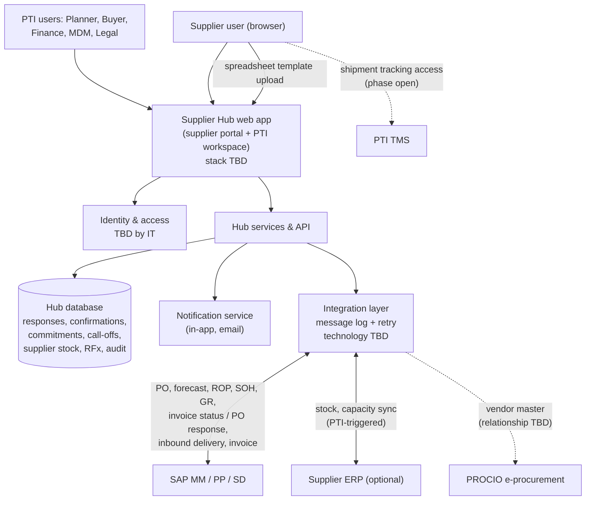
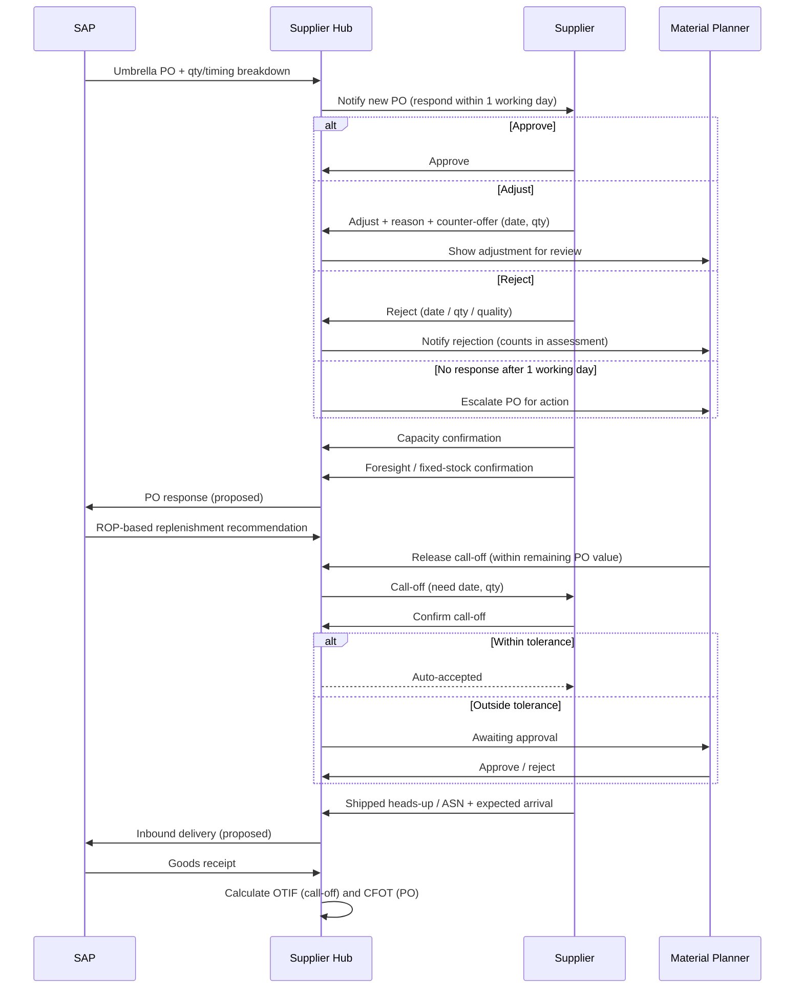

# Product Requirements Document: PTI Supplier Hub (MVP)

| | |
|---|---|
| Product | Supplier Hub (Supplier Portal, "SC Collaboration Hub") |
| Company | PT Paragon Technology and Innovation (PTI) |
| Version | 0.1 draft, 2026-09-17 |
| Scope | MVP (Phase 1, "Foundation to Transact"). Phase 2 and 3 appear only in section 9 |
| Project managers | Vergiant, Levi |
| Sources | Kick-off deck (Aug 2026), captured in `SUPPLIER-HUB-BASELINE.md`; business user feedback in `KICKOFF-MEETING-NOTES.md`; detailed requirements in `SUPPLIER-HUB-REQUIREMENTS.md` |
| Detail | This PRD summarises the product. Business rules, step-by-step walkthroughs, and full acceptance criteria live in `SUPPLIER-HUB-REQUIREMENTS.md`, referenced by `REQ-` ID |

**Status tags.** **[V]** validated with business users. **[D]** stated in the kick-off deck. **[P]** proposed by the analyst, needs review. **TBD** not decided; the owner is named where known.

---

## 1. Executive Summary

**Problem Statement.** PTI's supplier collaboration runs on email and Excel: supplier data is scattered, confirmations are manual, planners cannot see supplier stock or delivery progress, and supplier performance is not measured consistently [D]. Current supply confirmation reliability is below 50% and CFOT Material is 30%, so material is often not ready when the factory needs it [D, deck p.5].

**Proposed Solution.** A single web hub where PTI planners and buyers share POs, forecasts, and sourcing events with suppliers. Suppliers confirm quantities, dates, capacity, stock, and shipments in a structured, time-bound way. The hub measures CFOT per PO and OTIF per call-off from those confirmations [D, V].

**Success Criteria.**

| # | KPI | Target | Source |
|---|---|---|---|
| S1 | Application uptime, with no bug that impacts business | 99% | [D] KPI-01 |
| S2 | Eligible suppliers onboarded on time | 80% | [D] KPI-02 |
| S3 | Onboarded suppliers actively using the hub | 100% | [D] KPI-03. "Actively using" definition TBD |
| S4 | POs answered by the supplier within 1 working day | TBD. Baseline: confirmation reliability below 50% [D p.5] | [V] REQ-E07-02 |
| S5 | Supplier OTIF per call-off, and CFOT per PO | TBD. Baseline CFOT Material 30% [D p.5] | [D] KPI-05; [V] definitions |

Also tracked, targets TBD: optimize stock, meaning less excess, obsolete, and stock-out inventory (KPI-04), and procurement cycle time from sourcing to PO (KPI-06) [D].

---

## 2. User Experience & Functionality

### 2.1 User Personas

| Code | Persona | Organisation | Needs from the hub |
|---|---|---|---|
| MP | Material Planner | PTI | Know early whether supply is secured; see supplier and PTI stock; release call-offs; manage supplier access to PTI stock |
| BUY | Buyer | PTI Procurement | Find the right suppliers; run RFI, RFQ, RFP without email; use performance data in sourcing |
| FIN | Accounts Payable | PTI Finance | Receive invoices matched to receipts; pay accurately and on time |
| MDM | Master Data steward | PTI | Keep supplier master data governed and in sync with SAP MM |
| LEG | Legal reviewer | PTI | Validate supplier documents |
| SUP | Supplier user | Raw material and packaging suppliers | One place to see PTI demand and orders and to respond; channel suited to its digital maturity |
| ADM | Hub administrator | PTI IT | Configure reason codes, calendars, templates, tolerances; monitor integrations [P] |

MVP pilot suppliers: DP Group (Dynaplast, Rapid Plast), DKSH Indonesia, Lautan Luas [D].

### 2.2 User Stories and Acceptance Criteria

Stories are grouped by epic. **Req** is the detailed requirement.

#### Foundation (E01, E02): pending the Foundation team

The Foundation team details these stories with `prompts/foundation-requirements-contribution.md`. Story-level scope from the deck [D]:

| ID | Story | Req | Status |
|---|---|---|---|
| US-01 | As a supplier, I want to request registration and complete the onboarding questionnaire so that I can be qualified to supply PTI | REQ-E01 (reserved) | [D] |
| US-02 | As a buyer, I want a verification and approval workflow involving Master Data and Legal so that only qualified, compliant suppliers become active | REQ-E01 (reserved) | [D] |
| US-03 | As a supplier or PTI user, I want to maintain profile, bank data, and vendor documents, synced to SAP MM, so that master data stays correct | REQ-E02 (reserved) | [D] |
| US-04 | As a buyer, I want to deactivate or blacklist a supplier so that it cannot be selected for new business | REQ-E02 (reserved) | [D] |

Acceptance criteria: TBD by the Foundation team. Open decision: whether these epics are delivered in PROCIO, integrated with it, or built in the hub (DEC-05).

#### Order Collaboration (E07)

| ID | Story | Req | Status |
|---|---|---|---|
| US-10 | As a supplier, I want to see each umbrella PO with its quantity and timing breakdown from SAP so that I confirm against one reliable source | REQ-E07-01 | [V] |
| US-11 | As a supplier, I want to approve, adjust, or reject a PO within 1 working day so that PTI knows quickly whether supply is secured | REQ-E07-02 | [V] |
| US-12 | As a planner, I want POs with no response after 1 working day escalated to me so that I can act, for example by sourcing elsewhere | REQ-E07-02 | [V] |
| US-13 | As a planner or supplier, I want an Order Collaboration Summary per PO showing ASNs and the 3 confirmations so that I see at a glance whether an order is safe | REQ-E07-03 | [V] |
| US-14 | As a supplier, I want to create an ASN and confirm shipment start and expected completion so that PTI knows goods are coming | REQ-E07-04, REQ-E07-05 | [V] concept, [P] ASN fields |
| US-15 | As a supplier, I want to see goods receipts against my shipments and dispute discrepancies so that quantity differences are resolved early | REQ-E07-06 | [P] |
| US-16 | As a supplier, I want to submit invoices from my goods receipts and follow their status so that I am paid without paper exchange | REQ-E07-07 | [P] |

**Acceptance criteria.**
- US-10:
  - A new SAP PO appears with every breakdown line's quantity and date.
  - A supplier cannot open another supplier's PO.
- US-11:
  - Each PO shows a response deadline 1 working day after creation.
  - Adjust requires a predefined reason plus a counter-offer date and quantity.
  - Reject requires a cause: date, quantity, and/or quality.
  - A rejection notifies PTI and counts in the supplier assessment.
- US-12:
  - A PO with no response at the deadline is marked Escalated and listed for the planner.
- US-13:
  - The summary shows ASNs and the status of the capacity, foresight / fixed-stock, and shipping notice confirmations.
  - Each status opens its detail page.
  - Suppliers see only their own POs.
- US-14:
  - An ASN can be created only for an approved PO or confirmed call-off.
  - A submitted ASN increases in-transit quantity.
  - Shipment start and expected completion are recorded per PO.
- US-15 [P]:
  - A SAP goods receipt appears against its ASN.
  - A receipt outside tolerance is flagged.
  - The supplier can acknowledge or dispute it with a comment.
- US-16 [P]:
  - Invoices are created only from the supplier's own received goods receipts.
  - A duplicate invoice number is blocked.
  - Status updates come from SAP.

#### Inventory & Capacity Collaboration (E08)

| ID | Story | Req | Status |
|---|---|---|---|
| US-20 | As a planner, I want supplier SOH, PTI SOH, both ROPs, and upcoming quantity split into in production and in transit so that I see shortages coming | REQ-E08-01 | [V] |
| US-21 | As a supplier, I want to submit stock by spreadsheet template, API sync, or manual entry so that I can share data whatever my IT maturity | REQ-E08-02 | [V] |
| US-22 | As a planner, I want to grant selected suppliers access to PTI stock, optionally per consignment material, so that they can plan replenishment | REQ-E08-03 | [V] |
| US-23 | As a supplier, I want to confirm the production capacity I allocate to PTI per week so that PTI sees capacity gaps early | REQ-E08-04 | [V] concept, [P] detail |
| US-24 | As a planner, I want risk-classified alerts for stock, capacity, and stale data so that I act before a stock-out | REQ-E08-05 | [P] |

**Acceptance criteria.**
- US-20:
  - The view shows supplier SOH, PTI SOH, PTI ROP, supplier ROP, and incoming split into in production and in transit.
  - There is no "available stock" field.
  - Raw material and packaging can be viewed separately.
  - Each supplier figure shows its last update time.
- US-21:
  - Template upload and manual entry work for suppliers.
  - A PTI user can trigger API sync with a Sync button.
  - Invalid template rows are listed with a reason, and valid rows are saved.
- US-22:
  - A supplier without access sees no PTI stock anywhere.
  - A Material Planner grants and removes access without supplier approval.
  - Every change is logged.
- US-23 [P]:
  - Capacity is entered per material group per week.
  - A week below demand requires a reason.
  - The planner sees gap weeks highlighted.
- US-24 [P]:
  - Each alert rule fires on test data.
  - Every alert has a High, Medium, or Low class.
  - A repeating condition creates no duplicate open alert.

#### Forecast Collaboration (E06)

| ID | Story | Req | Status |
|---|---|---|---|
| US-30 | As a supplier, I want to see PTI's material forecast per period, with firm, trade-off, and forecast zones and changes since the last version, so that I can plan production | REQ-E06-01 | [P] |
| US-31 | As a supplier, I want to commit a quantity and date per period, with a reason when below forecast, so that PTI knows what supply is secured | REQ-E06-02 | [V] concept, [P] detail |
| US-32 | As a planner, I want forecast-versus-commitment gaps coloured by tolerance and ranked by impact so that I focus on real risks | REQ-E06-03 | [P] |

**Acceptance criteria.**
- US-30 [P]:
  - Each period shows quantity and zone.
  - Current and previous versions can be compared.
  - The forecast can be downloaded as a spreadsheet.
  - Suppliers see only their own materials.
- US-31 [P]:
  - Commitments can be made on screen or by upload.
  - A commitment below forecast requires a reason.
  - Commitments within tolerance need no planner action.
  - Missing commitments escalate.
- US-32 [P]:
  - Gaps are shown as quantity and percentage, coloured by tolerance.
  - Firm-zone exceptions are listed first.
  - Planner actions are saved with a note and visible to the supplier.

#### Call-off Management (E09)

| ID | Story | Req | Status |
|---|---|---|---|
| US-40 | As a planner, I want SAP's ROP-based recommendations as a release list so that call-offs follow the model instead of memory | REQ-E09-01 | [V] SAP source, [P] detail |
| US-41 | As a planner, I want to compare ROP and event-based strategies for launches, promotions, and supply crises so that I can propose parameter changes | REQ-E09-02 | [P], MVP need open (PQ-09) |
| US-42 | As a supplier, I want to confirm each call-off, with automatic acceptance within tolerance, so that every delivery has a clear commitment | REQ-E09-03 | [P] |
| US-43 | As a supplier, I want to send a "shipped" heads-up with expected arrival so that PTI knows supply is on its way | REQ-E09-04 | [V] scope, [P] detail |

**Acceptance criteria.**
- US-40:
  - Recommendations show quantity, date, and inventory context.
  - Release, edit, and dismiss are available, with a reason for edit and dismiss.
  - Release is blocked beyond the remaining umbrella PO value.
- US-41 [P]:
  - Projected stock under current and event-based strategy can be compared and shared.
- US-42 [P]:
  - Each line can be confirmed, confirmed with a new date or quantity, or rejected.
  - A confirmation within tolerance is auto-accepted; outside tolerance it awaits planner approval.
  - No response after 1 working day escalates.
  - OTIF is calculated against the approved date and quantity.
- US-43:
  - A confirmed call-off can be marked shipped with expected arrival.
  - It shows as Dispatched and in transit.
  - An expected arrival after the need date is flagged At Risk.
  - No dock or slot booking exists.

#### RFx Management (E03)

| ID | Story | Req | Status |
|---|---|---|---|
| US-50 | As a buyer, I want to filter suppliers by commodity, purchasing group, and further parameters, with their OTIF visible, so that I invite the right suppliers | REQ-E03-01 | [V] |
| US-51 | As a buyer, I want to send an RFI and receive capability, experience, facility, and product information so that I know what suppliers can offer | REQ-E03-02 | [V] |
| US-52 | As a buyer, I want to create an RFQ, from scratch or from an RFI, so that I collect comparable quotes | REQ-E03-03 | [V] |
| US-53 | As a buyer, I want to send an RFP asking for commercial terms so that I can compare proposals term by term | REQ-E03-04 | [V] |

**Acceptance criteria.**
- US-50:
  - Filters by commodity and purchasing group work alone and combined.
  - Each supplier shows OTIF or "No history".
  - Blacklisted and deactivated suppliers are hidden.
- US-51:
  - An RFI can be sent with no RFQ.
  - Suppliers submit capability, experience, facility, and product entries, each with a description.
- US-52:
  - An RFQ can be created with or without an RFI.
  - When created from an RFI, specifications and invitees are pre-filled.
  - Suppliers cannot see each other's quotes.
- US-53:
  - An RFP lists required commercial terms.
  - Suppliers respond per term.

#### Supplier Performance (E10)

| ID | Story | Req | Status |
|---|---|---|---|
| US-60 | As a buyer or planner, I want CFOT per PO and OTIF per call-off per supplier so that performance drives sourcing decisions | REQ-E10-01 | [V] definitions, [P] formulas |

**Acceptance criteria.**
- US-60:
  - The dashboard shows CFOT and OTIF per supplier for a chosen period.
  - OTIF is calculated per call-off and CFOT per PO.
  - Formulas are confirmed by the business before build.

### 2.3 Non-Goals (MVP)

| Not building in MVP | Why | Source |
|---|---|---|
| Contract management, catalog management, spend and reporting analytics | Phase 2 | [D] p.9 |
| API integration with a shipment aggregator | Phase 2. Supplier access to PTI's TMS may come earlier, phase open (D-03) | [D] p.9; [V] MN-INV-13 |
| Supplier Quality module | Phase 2 | [D] p.9 |
| Web scraping and AI for sourcing | Phase 3 | [D] p.9 |
| Dock, slot, or delivery schedule management | Only a shipped heads-up is needed now | [V] PQ-10 |
| Calculating forecasts, ROP, or replenishment in the hub | These come from SAP | [V] MN-INV-14 |
| An "available stock" figure | On-hand is enough; stock is deducted as used | [V] Q-02 |
| Sending call-offs to SAP | Call-offs are managed outside SAP today; the hub becomes their record | [V] PQ-01; [P] PQ-11 |
| Supplier approval of PTI stock access changes | PTI decides | [V] Q-06 |
| Bid comparison, negotiation, and awarding detail | Not yet detailed; stub | [D] REQ-E03-05 |

---

## 3. AI System Requirements (If Applicable)

**Not applicable to the MVP.** No MVP requirement uses AI [scope decision, 2026-09-17].

**Phase 3 outline: web scraping and AI for sourcing** [D p.9]. Not yet scoped. The items below mark what must be defined before Phase 3 design, and nothing here is decided.

- **Tool Requirements.** TBD:
  - Sources to scrape and their terms of use.
  - Model or service for supplier discovery and matching.
  - Link to RFI data (REQ-E03-02) and supplier master data.
- **Evaluation Strategy.** TBD:
  - A benchmark set of past sourcing needs with the suppliers buyers actually shortlisted.
  - Pass criteria set by Procurement.
  - Legal review of scraping and data use before build.

---

## 4. Technical Specifications

The production tech stack, hosting, database, and authentication are **TBD by IT**, which owns technical delivery, integration, and security [D p.12]. This section defines the product's components and data flows at a level IT can choose a stack for.

### 4.1 Architecture Overview

| Component | Responsibility | Status |
|---|---|---|
| Supplier Hub web application | 1 web application with a supplier portal and a PTI internal workspace, role-based | [P]; stack TBD |
| Hub services and API | Business logic: PO responses, confirmations, commitments, call-offs, stock submissions, alerts, metrics | [P]; stack TBD |
| Hub database | System of record for data SAP does not hold: responses, confirmations, commitments, call-offs, supplier stock, access grants, RFx events, audit log | [P]; call-offs follow from [V] PQ-01 |
| Integration layer | Exchange with SAP and supplier systems; message log and retry | [P]; technology TBD (PQ-06) |
| SAP (MM, PP, SD) | System of record for umbrella PO (value), forecast and ROP recommendations, goods receipts, invoices, vendor master | [D p.5]; [V] |
| Supplier ERP (optional) | Stock and capacity sync by API for connected suppliers, such as DP Group | [D p.11]; [V] MN-INV-07 |
| PTI TMS | Supplier shipment tracking; phase open | [V] MN-INV-13; D-03 |
| PROCIO | E-procurement application linked to Foundation epics; relationship TBD | [D p.6]; DEC-05 |
| Notification service | In-app and email notifications | [P] |
| Identity and access | PTI employees and external supplier users | TBD by IT |

**Data flow summary.**
1. SAP publishes POs, forecasts, ROP recommendations, goods receipts, and invoice status to the hub.
2. Suppliers respond in the hub. Responses, commitments, and confirmations are stored in the hub.
3. PO responses, ASNs (as inbound deliveries), and invoices flow back to SAP [P].
4. Call-offs stay in the hub [V PQ-01].
5. Metrics are calculated from hub and SAP data.

### 4.2 Integration Points

| # | Object | From | To | Mode | Status |
|---|---|---|---|---|---|
| I1 | Umbrella PO (value) and quantity/timing breakdown | SAP | Hub | Scheduled or event, TBD | [V] MN-ORD-03, PQ-01; quantity per line open (PQ-12) |
| I2 | PO response (approve, adjust, reject) | Hub | SAP | TBD | [P] |
| I3 | Forecast / net requirements | SAP | Hub | Weekly publication [P] | [P]; SAP source open (PQ-07) |
| I4 | ROP and replenishment recommendation | SAP | Hub | TBD | [V] MN-INV-14 |
| I5 | PTI stock on hand | SAP | Hub | TBD | [V] MN-INV-03 |
| I6 | Supplier stock, ROP, in production | Supplier ERP, spreadsheet, manual | Hub | API sync on PTI button; upload; screen | [V] MN-INV-07 |
| I7 | ASN as inbound delivery | Hub | SAP | TBD | [D] E07.05; [P] |
| I8 | Goods receipt | SAP | Hub | TBD | [D] E07.03; [P] |
| I9 | Invoice and invoice status | Hub to SAP; SAP to Hub | Both | TBD | [D] E07.04; [P] |
| I10 | Vendor master | Hub or PROCIO | SAP MM | TBD | [D] E02.04; DEC-05 |
| I11 | Shipment tracking | TMS | Supplier (access), Hub | TBD | [V] MN-INV-13; D-03 |
| I12 | Notifications | Hub | Email | TBD | [P] |

### 4.3 Security & Privacy

| # | Requirement | Status |
|---|---|---|
| SP1 | A supplier user sees only its own company's POs, call-offs, forecasts, stock, invoices, and RFx invitations | [V] MN-ORD-13; [P] extended to all objects |
| SP2 | PTI stock is visible only to suppliers granted access by a Material Planner, optionally limited to materials | [V] MN-INV-08 to MN-INV-12 |
| SP3 | Quotes and proposals of one supplier are never visible to another supplier | [P] |
| SP4 | Grants, responses, approvals, and master data changes are written to an audit log with user and time | [P] |
| SP5 | Bank data and vendor documents are restricted to authorised PTI roles and the owning supplier | [P]; Foundation team to confirm |
| SP6 | Personal data of supplier users is handled in line with Indonesia's Personal Data Protection Law (UU No. 27 Tahun 2022) | [P]; Legal to confirm scope |
| SP7 | Authentication method for PTI users and suppliers, password and session policy, encryption at rest and in transit | TBD by IT |

---

## 5. User Flow (Mermaid Diagrams)

### 5.1 System Architecture Diagram



### 5.2 Request Lifecycle Diagram: umbrella PO to delivery



---

## 6. Testing Scenarios

### 6.1 Functional Tests

| # | Scenario | Input | Expected outcome | Pass criteria |
|---|---|---|---|---|
| T1 | New PO from SAP | PO with 3 breakdown lines | PO visible to its supplier with 3 lines | All 3 quantities and dates match SAP |
| T2 | PO visibility isolation | Supplier B opens supplier A's PO URL | Access denied | No PO data returned |
| T3 | Adjust without reason | Adjust with counter-offer, no reason | Submission blocked | Error names the missing reason |
| T4 | Reject | Reject with cause "quality" | PTI notified; rejection stored | Notification names supplier; rejection appears in assessment data |
| T5 | No response | PO created, 1 working day passes | PO Escalated | PO in planner's escalation list |
| T6 | Summary links | Open capacity status in summary | Capacity confirmation page for that PO | Same PO ID on target page |
| T7 | Template upload with bad rows | 10 rows, 2 invalid materials | 8 saved, 2 listed with reasons | Counts and reasons exact |
| T8 | API sync button | PTI presses Sync for connected supplier | Supplier figures refreshed | Last update time changes; values match supplier system |
| T9 | Stock access removed | Planner removes supplier's access | Supplier no longer sees PTI stock | No PTI stock on any supplier page; change logged |
| T10 | Inventory view | Material with supplier and PTI data | SOH x2, ROP x2, incoming split | No "available" field; raw material and packaging separable |
| T11 | Call-off beyond PO value | Release exceeding remaining umbrella PO value | Release blocked | Error names remaining value |
| T12 | Call-off within tolerance [P] | Supplier confirms 1 day late, tolerance 1 day | Auto-accepted | Status Confirmed with New Date, no approval task |
| T13 | Call-off outside tolerance [P] | Supplier confirms 2 days late, tolerance 1 day | Awaiting approval | Approval task for planner |
| T14 | Shipped heads-up late | Expected arrival after need date | Call-off At Risk | Flag visible to planner |
| T15 | Commitment below forecast [P] | Commit 800 of 1,000 without reason | Blocked | Error names the missing reason |
| T16 | RFQ from RFI | Create RFQ from closed RFI | Specs and invitees pre-filled | Fields match RFI; all editable |
| T17 | Supplier filter | Commodity + purchasing group | Matching active suppliers with OTIF | No blacklisted or deactivated supplier listed |
| T18 | OTIF calculation [P formula] | Call-off received in full on need date | OTIF = 1 for that call-off | Dashboard reflects it for the period |
| T19 | Duplicate invoice [P] | Same invoice number twice from one supplier | Second blocked | Error names duplicate |

### 6.2 Non-Functional Tests

| # | Scenario | Metric | Threshold |
|---|---|---|---|
| NF1 | Availability | Monthly application uptime | 99%, with no business-impacting bug [D KPI-01] |
| NF2 | Page response | p95 page load for PO list and inventory view | TBD by IT |
| NF3 | Concurrent users | Simultaneous PTI and supplier sessions without degradation | TBD by IT |
| NF4 | Upload size | Maximum rows and file size for stock template | TBD by IT |
| NF5 | Data freshness | Delay from SAP change to hub display | TBD by IT (PQ-06) |
| NF6 | Deadline accuracy | Escalation fires at the working-day deadline | TBD tolerance; calendar per Q-18 |
| NF7 | Recovery | Restore time after outage; data loss window | TBD by IT |

---

## 7. Edge Cases

### 7.1 Failure Modes

| # | Edge case | Handling | Status |
|---|---|---|---|
| E1 | SAP unavailable | Hub keeps working on last data, shows data age, queues outbound messages | [P] |
| E2 | Supplier API sync fails | Show error and time; keep previous figures flagged stale | [P] |
| E3 | Integration message fails | Logged as failed with error; administrator retries | [P] |
| E4 | Email notification fails | In-app notification remains; failure logged | [P] |
| E5 | Supplier responds after escalation | Response recorded with lateness; escalation stays visible | [P] |

### 7.2 Input Validation

| # | Edge case | Handling | Status |
|---|---|---|---|
| E6 | Adjust or reject without required reason, counter-offer, or cause | Block submission, name missing fields | [V] rules; [P] handling |
| E7 | Template row for a material not assigned to the supplier | Reject that row, accept valid rows | [P] |
| E8 | Malformed or oversize upload | Reject file with reason; size limit TBD | [P]; NF4 |
| E9 | Duplicate invoice number | Block | [P] |
| E10 | Call-off exceeds remaining umbrella PO value | Block release | [P]; follows [V] PQ-01 |
| E11 | Commitment below forecast without reason | Block | [P] |

### 7.3 Data Integrity

| # | Edge case | Handling | Status |
|---|---|---|---|
| E12 | PO changed in SAP after supplier confirmed | Return PO to awaiting response; notify supplier | [P] |
| E13 | Forecast re-published after commitment | Periods changed beyond tolerance return to awaiting commitment; others keep commitment | [P] |
| E14 | Supplier stock not updated for a long time | Show last update; flag stale after configurable period | [P] |
| E15 | Goods receipt with no ASN | Show "Received without ASN"; count in ASN coverage | [P] |
| E16 | Access to PTI stock removed during a session | Next page load hides PTI stock | [P] |
| E17 | Two planners act on the same exception | Last action wins only if based on current version; otherwise reload prompt | [P] |
| E18 | PO created on a non-working day | Deadline counts from next working day | [P]; Q-18 |

---

## 8. API Contract

**The whole contract is Proposed.** Paths, field names, and codes are illustrative so IT and the build team can agree a contract. Authentication scheme, base URL, versioning, and rate limits are TBD by IT. The examples use `Bearer` tokens only as a placeholder.

### 8.1 Endpoints (MVP core)

| Method | Path | Purpose | Caller | Req |
|---|---|---|---|---|
| GET | `/api/v1/pos` | List umbrella POs for the caller's company or PTI | SUP, MP | REQ-E07-01 |
| GET | `/api/v1/pos/{poId}` | PO with breakdown, response, confirmations, ASNs | SUP, MP | REQ-E07-01, REQ-E07-03 |
| POST | `/api/v1/pos/{poId}/response` | Approve, adjust, or reject | SUP | REQ-E07-02 |
| POST | `/api/v1/pos/{poId}/confirmations/capacity` | Capacity confirmation | SUP | REQ-E08-04 |
| POST | `/api/v1/forecast-versions/{versionId}/commitments` | Foresight / fixed-stock commitments | SUP | REQ-E06-02 |
| POST | `/api/v1/stock-submissions` | Manual stock entry | SUP | REQ-E08-02 |
| POST | `/api/v1/stock-submissions/upload` | Spreadsheet template upload (multipart) | SUP | REQ-E08-02 |
| POST | `/api/v1/suppliers/{supplierId}/stock-sync` | Trigger supplier API sync | MP | REQ-E08-02 |
| PUT | `/api/v1/suppliers/{supplierId}/pti-stock-access` | Grant or remove access to PTI stock | MP | REQ-E08-03 |
| POST | `/api/v1/call-offs` | Release call-off | MP | REQ-E09-01 |
| POST | `/api/v1/call-offs/{callOffId}/confirmation` | Confirm call-off | SUP | REQ-E09-03 |
| POST | `/api/v1/call-offs/{callOffId}/dispatch` | Shipped heads-up | SUP | REQ-E09-04 |
| POST | `/api/v1/asns` | Create ASN | SUP | REQ-E07-04 |
| GET | `/api/v1/alerts` | Alerts for the caller | MP, SUP | REQ-E08-05 |
| GET | `/api/v1/suppliers?commodity=&purchasingGroup=` | Filter suppliers with OTIF | BUY | REQ-E03-01 |

**Common headers.**

| Header | Required | Description |
|---|---|---|
| `Authorization` | Yes | `Bearer <token>` (scheme TBD by IT) |
| `Content-Type` | Yes on POST/PUT | `application/json`, or `multipart/form-data` for upload |
| `If-Match` | Yes on PO response and call-off confirmation | Version of the object the user saw, to detect changes (E12) |
| `X-Request-ID` | No | UUID for tracing |

### 8.2 Request/Response Schema

#### `POST /api/v1/pos/{poId}/response` (adjust)

Request:

```json
{
  "action": "adjust",
  "lines": [
    {
      "lineId": "PO-4500012345-20",
      "reasonCode": "PRODUCTION_CAPACITY",
      "counterOffer": { "quantity": 800, "date": "2026-11-14" }
    }
  ],
  "comment": "Line 2 moved one week due to planned maintenance"
}
```

Success `200 OK`:

```json
{
  "poId": "4500012345",
  "responseStatus": "adjusted",
  "respondedAt": "2026-10-05T08:12:00+07:00",
  "deadline": "2026-10-06T08:00:00+07:00",
  "withinDeadline": true,
  "version": 4
}
```

Rules: `action` is one of `approve`, `adjust`, `reject` [V]. `adjust` requires `reasonCode` from the predefined list and `counterOffer` per adjusted line [V]. `reject` requires `causes`, a subset of `["date","quantity","quality"]` [V].

#### `POST /api/v1/stock-submissions/upload`

Request: `multipart/form-data` with field `file` (template spreadsheet).

Success `200 OK` (partial acceptance):

```json
{
  "submissionId": "stk-20261005-0042",
  "rowsReceived": 10,
  "rowsAccepted": 8,
  "rowsRejected": [
    { "row": 4, "code": "MATERIAL_NOT_ASSIGNED", "message": "Material 10002233 is not assigned to this supplier" },
    { "row": 9, "code": "INVALID_QUANTITY", "message": "SOH must be a number >= 0" }
  ]
}
```

#### `POST /api/v1/call-offs/{callOffId}/confirmation`

Request:

```json
{
  "lines": [
    { "lineId": "CO-000781-1", "decision": "confirm_new_date", "quantity": 2000, "date": "2026-10-14" }
  ]
}
```

Success `200 OK`:

```json
{
  "callOffId": "CO-000781",
  "status": "awaiting_approval",
  "lines": [
    {
      "lineId": "CO-000781-1",
      "confirmationStatus": "confirmed_with_new_date",
      "withinTolerance": false,
      "toleranceRule": { "lateDays": 1 }
    }
  ],
  "version": 2
}
```

A confirmation outside tolerance is not an error. It returns `awaiting_approval` [P, Market].

#### Error body (all endpoints)

```json
{
  "error": {
    "code": "REASON_REQUIRED",
    "message": "Adjusted line PO-4500012345-20 needs a reason code.",
    "field": "lines[0].reasonCode",
    "retryable": false
  }
}
```

### 8.3 Error Codes

| Status | Code | When | Retry |
|---|---|---|---|
| `400` | `INVALID_REQUEST` | Malformed JSON or missing required field | No; fix request |
| `401` | `UNAUTHORIZED` | Missing or expired credentials | After re-authentication |
| `403` | `FORBIDDEN` | Role not allowed, such as a supplier releasing a call-off | No |
| `404` | `NOT_FOUND` | Object missing, or belongs to another supplier (not disclosed as 403) | No |
| `409` | `VERSION_CONFLICT` | `If-Match` version is not current, such as a PO changed in SAP | After reloading the object |
| `422` | `REASON_REQUIRED` | Adjust or commitment below forecast without reason | No; add reason |
| `422` | `COUNTER_OFFER_REQUIRED` | Adjust without date and quantity | No |
| `422` | `CAUSE_REQUIRED` | Reject without date, quantity, or quality cause | No |
| `422` | `EXCEEDS_UMBRELLA_PO_VALUE` | Call-off release beyond remaining PO value | No |
| `422` | `DUPLICATE_INVOICE` | Invoice number already submitted | No |
| `413` | `FILE_TOO_LARGE` | Upload above limit (limit TBD, NF4) | No; split file |
| `429` | `RATE_LIMITED` | Rate limit TBD by IT | After `retry_after_s` |
| `502` | `SUPPLIER_SYSTEM_ERROR` | Supplier API sync failed | Yes, with backoff |
| `503` | `SAP_UNAVAILABLE` | SAP needed synchronously and unreachable | Yes, with backoff; outbound messages are queued |

---

## 9. Risks & Roadmap

### 9.1 Phased Rollout

Dates are indicative, per the deck, until resources and MVP scope are agreed [D p.10].

| Release | Deck phase | Indicative timing | Scope |
|---|---|---|---|
| Discovery & Design | | Aug to Sep 2026 | Requirements, design, integration discovery |
| **MVP** | Phase 1: Foundation to Transact | Build Oct 2026 to Mar 2027; go-live about end of Mar 2027 | Registration and onboarding; master data; Order, Inventory & Capacity, Forecast Collaboration; Call-off Management; API ERP; RFx; Supplier Performance Dashboard. Pilot: DP Group, DKSH, Lautan Luas |
| **v1.1** | Phase 2 | Apr to May 2027 | Contract Management; Catalog Management; Reporting & Analytics; API Shipment Aggregator; Supplier Quality |
| **v2.0** | Phase 3 | Not scheduled on the deck timeline | Web scraping and AI for sourcing |

Hypercare and stabilisation run from Oct 2026 to about mid-Apr 2027 on the deck. The early start is flagged as a deck inconsistency (CON-08).

### 9.2 Technical Risks

| # | Risk | Impact | Mitigation | Status |
|---|---|---|---|---|
| R1 | ERP API endpoints not ready for master data and transaction sync | Blocks I1 to I10; MVP go-live | Agree interface list and owners in Discovery; build against mocks; ERP functional team allocated [D p.13] | [D] RSK-01; mitigation [P] |
| R2 | Suppliers or aggregators reluctant to open APIs | Stock sync limited | Spreadsheet and manual channels in MVP | [D] RSK-02; mitigation [V] MN-INV-07 |
| R3 | Resistance to change from suppliers and internal users | Low use, KPI-03 missed | Pilot with 3 suppliers; key users per team [D p.13] | [D] RSK-03 |
| R4 | Low supplier digital literacy | Slow adoption | Manual entry and spreadsheet channels; simple response flows | [D] RSK-04 |
| R5 | Poor data quality (stock, forecast, master data) | Wrong alerts and metrics | Last-update times, stale flags, MDM validation | [D] RSK-05; mitigation [P] |
| R6 | Deployment delay from scope creep or missing resources | Go-live slips | Non-goals in section 2.3; Software Engineer & QA role is vacant and must be filled [D p.13] | [D] RSK-06 |
| R7 | Integration errors between PTI and supplier ERPs | Wrong stock figures | Message log, retry, data-age warnings | [D] RSK-07; mitigation [P] |
| R8 | Call-offs managed manually outside SAP today, so the hub becomes their only record | Data migration, reconciliation with SAP receipts | Decide migration and reconciliation (PQ-11); link receipts via ASN | [V] PQ-01; [P] |
| R9 | Umbrella PO holds value only | Quantity-based checks may be impossible | Confirm PQ-12 | [V] PQ-01; open |
| R10 | Foundation relationship with PROCIO undecided | Onboarding and master data design blocked | Decide DEC-05 in Discovery | [D] |

### 9.3 Open Decisions Blocking the MVP

| ID | Decision | Owner |
|---|---|---|
| PQ-11 | Hub as record for call-offs; migration of manual records; any sync back | Material Planner, IT |
| PQ-12 | Umbrella PO: value only, or quantities per line | Material Planner, ERP Functional |
| DEC-05 | Foundation in PROCIO, integrated, or built | Procurement, IT |
| DEC-03 | Final MVP list (RFx and performance dashboard in MVP; D-07 catalog for RFI; D-03 TMS phase) | Project sponsors |
| PQ-07 | SAP source of forecast and demand sensing | Material Planner, ERP Functional |
| PQ-08, PQ-02 | Tolerances, commitment deadline, forecast horizon and zones | Material Planner |
| Q-18 | Working calendar for the 1-working-day deadline | Material Planner |
| KPI | Targets for S4, S5, KPI-04, KPI-06; CFOT and OTIF formulas | Project sponsors, Material Planner |
| IT | Tech stack, hosting, authentication, NFR thresholds (NF2 to NF7), interface technology (PQ-06) | IT |

The full list is in section 7 of `SUPPLIER-HUB-REQUIREMENTS.md`.
