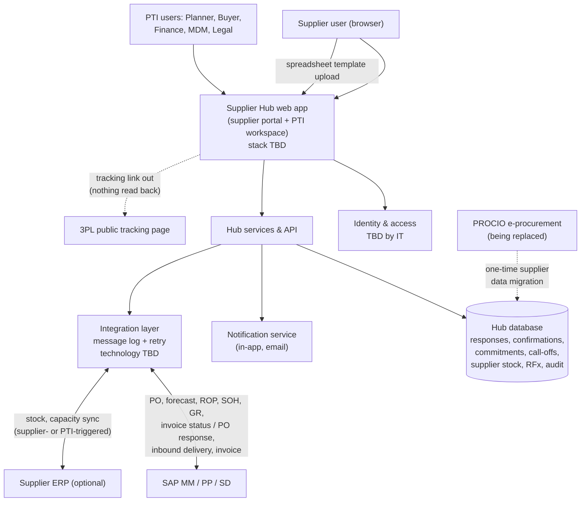
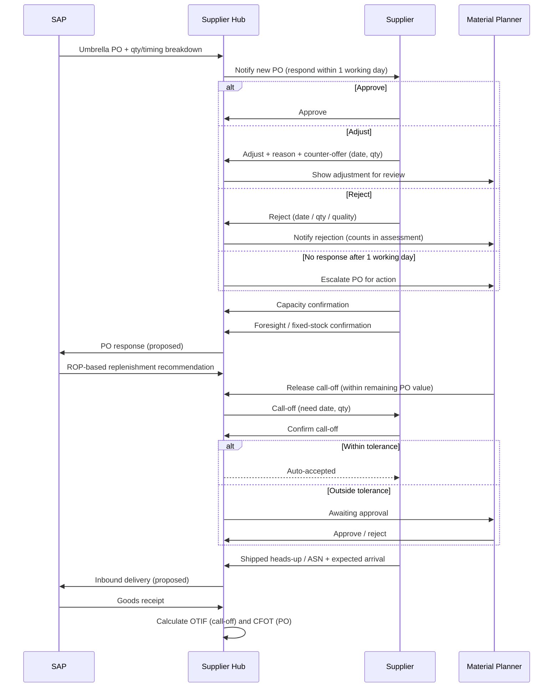

# Product Requirements Document: PTI Supplier Hub (MVP)

| | |
|---|---|
| Product | Supplier Hub (Supplier Portal, "SC Collaboration Hub") |
| Company | PT Paragon Technology and Innovation (PTI) |
| Version | 0.11 draft, 2026-09-28 |
| Scope | MVP (Phase 1, "Foundation to Transact"). Phase 2 and 3 appear only in section 9 |
| Steering Committee | Yogi Sapta Prakoso (VP Supply Chain), Ilauddin (CFO), Risman Adnan (CTO) [C] |
| Technology Product Owners | Achmad Fahlevi, Vergiant Yoga Perdana (Supply Chain); Indita Ramasaphira (FATL) [C] |
| Project Manager | Zanjabila Aulia (IT PMO) [C] |
| Sources | Project Charter, SC Collaboration Hub Proposal (Sep 2026) for business numbers, scope, and milestones; Risk Assessment workbook (6 Aug 2026) for risks; kick-off deck (Aug 2026), captured in `SUPPLIER-HUB-BASELINE.md`; business user feedback in `KICKOFF-MEETING-NOTES.md`; detailed requirements in `SUPPLIER-HUB-REQUIREMENTS.md` |
| Detail | This PRD summarises the product. Business rules, step-by-step walkthroughs, full acceptance criteria, shared calculation rules (`CR-`), navigation (`NV-`), and screen conventions (`SC-`) live in `SUPPLIER-HUB-REQUIREMENTS.md`. What the prototype already does is tracked only in `BUILD-GAP.md` |

**Status tags.** **[C]** stated in the project charter. **[R]** stated in the risk register. **[V]** validated with business users. **[D]** stated in the kick-off deck. **[P]** proposed by the analyst, needs review. **TBD** not decided; the owner is named where known.

---

## 1. Executive Summary

**Problem Statement.** Forecasts, order confirmations, supplier stock, delivery commitments, sourcing, and supplier performance are exchanged by email, chat, and spreadsheets across more than 500 direct and 5,000 indirect suppliers, so supply risks surface late [C]. In 2026, material supply issues were associated with about IDR 161 billion in average monthly lost sales [C].

**Proposed Solution.** A single web hub where PTI planners and buyers share POs, forecasts, and sourcing events with suppliers. Suppliers confirm quantities, dates, capacity, stock, and shipments in a structured, time-bound way. The hub measures CFOT per PO and OTIF per call-off from those confirmations [D, V].

**Success Criteria.**

| # | KPI | Baseline | Target | Source |
|---|---|---|---|---|
| S1 | Platform availability during production operation, excluding planned maintenance | New platform | ≥ 99% | [C]; [D] KPI-01 |
| S2 | Targeted suppliers onboarded according to rollout plan | New platform | ≥ 80% | [C]; [D] KPI-02 |
| S3 | Targeted suppliers actively using the platform within the agreed adoption period | New platform | ≥ 80% | [C]. The deck said 100% (KPI-03); see section 9.4 |
| S4 | Supply-to-production confirmation accuracy | 60% | 80% | [C] |
| S5 | Optimized stock | 20% | 40% | [C]. Metric definition TBD; linked to deck KPI-04 |

**Further success criteria from the charter** [C]:
- Sourcing administration time: 8 hours → 1 hour per week.
- Sourcing documentation with an audit trail: 100%.
- Supplier data and files managed in the database: 100%.
- CSAT: minimum 4 out of 5.

**Still without a target** (not in the charter or the deck): CFOT per PO, share of POs answered within 1 working day, procurement cycle time (deck KPI-06). Supplier OTIF per call-off uses the prototype's working target of 90% (CR-17) until the Steering Committee sets one.

**Business case** [C]. Monthly value of the problem addressed, as calculated in the charter:

| Benefit | IDR per month | Charter basis |
|---|---|---|
| Lost-sales risk reduced | 32,000,000,000 | 20% of the IDR 161 billion average monthly lost sales from material supply issues, benchmark from a similar project |
| Warehouse rent reduced | 500,000,000 | Inventory reduction of 20 to 30% from supply visibility, citing McKinsey research |
| Airfreight reduced | 360,000,000 | 30% of about IDR 1.2 billion monthly airfreight, benchmark from a similar project |
| Administration reduced | 7,000,000 | Material Planner demand anticipation 90 → 18 hours per month; expeditor call-off calculation and consolidation 85 → 43 hours per month |
| **Total** | **≈ 32,867,000,000** | Sum of the rows above |

The benchmark percentages come from the charter and were not verified for this PRD.

**Other expected benefits** [C]:
- 80% less manual communication.
- Forecast, demand collaboration, and inbound delivery input lead time: 2 weeks → 1 day.
- 80% fewer material shortages caused by late supplier information.
- 90% better supply visibility for working capital and inventory.
- About 1% human error.
- All supplier data maintained in the database.
- Visibility of supplier spend.
- More accurate awarding decisions and more effective negotiation.

---

## 2. User Experience & Functionality

### 2.1 User Personas

| Code | Persona | Organisation | Needs from the hub |
|---|---|---|---|
| MP | Material Planner | PTI | Know early whether supply is secured; see supplier and PTI stock; release call-offs; manage supplier access to PTI stock |
| BUY | Buyer | PTI Procurement | Find the right suppliers; run RFI, RFQ, RFP without email; use performance data in sourcing |
| FIN | Accounts Payable | PTI Finance | Receive invoices matched to receipts; pay accurately and on time |
| MDM | Master Data steward | PTI | Keep supplier master data governed and in sync with SAP MM |
| LEG | Legal reviewer | PTI | Validate supplier documents |
| SUP | Supplier user | Raw material and packaging suppliers | One place to see PTI demand and orders and to respond; channel suited to its digital maturity |
| ADM | Hub administrator | PTI IT | Maintain the hub working calendar (loaded from SAP) and the 3PL tracking list; configure reason codes, templates, tolerances; monitor integrations [Owner 2026-09-21; rest P] |

MVP pilot suppliers: DP Group (Dynaplast, Rapid Plast), DKSH Indonesia, Lautan Luas [D].

### 2.2 User Stories and Acceptance Criteria

Stories are grouped by epic. **Req** is the detailed requirement.

#### Foundation (E01, E02): pending the Foundation team

The Foundation team details these stories with `prompts/foundation-requirements-contribution.md`. Story-level scope from the deck [D]:

| ID | Story | Req | Status |
|---|---|---|---|
| US-01 | As a supplier, I want to request registration and complete the onboarding questionnaire so that I can be qualified to supply PTI | REQ-E01 (reserved) | [D] |
| US-02 | As a buyer, I want a verification and approval workflow involving Master Data and Legal so that only qualified, compliant suppliers become active | REQ-E01 (reserved) | [D] |
| US-03 | As a supplier or PTI user, I want to maintain profile, bank data, and vendor documents, synced to SAP MM, so that master data stays correct | REQ-E02 (reserved) | [D] |
| US-04 | As a buyer, I want to deactivate or blacklist a supplier so that it cannot be selected for new business | REQ-E02 (reserved) | [D] |

Acceptance criteria: TBD by the Foundation team. The hub **replaces PROCIO** for registration, onboarding, and supplier master data [owner decision, 2026-09-17], so supplier data held in PROCIO must be migrated.

#### Order Collaboration (E07)

| ID | Story | Req | Status |
|---|---|---|---|
| US-10 | As a supplier, I want to see each umbrella PO with its quantity and timing breakdown from SAP so that I confirm against one reliable source | REQ-E07-01 | [V] |
| US-11 | As a supplier, I want to approve, adjust, or reject a PO within 1 working day so that PTI knows quickly whether supply is secured | REQ-E07-02 | [V] |
| US-12 | As a planner, I want POs with no response after 1 working day escalated to me so that I can act, for example by sourcing elsewhere | REQ-E07-02 | [V] |
| US-13 | As a planner or supplier, I want an Order Collaboration Summary per PO covering response, ASNs, call-offs, the 3 confirmations, receipts and invoices, where every figure opens the record behind it, so that I see at a glance whether an order is safe and can act without hunting | REQ-E07-03 | [V] |
| US-14 | As a supplier, I want to create an ASN and confirm shipment start and expected completion so that PTI knows goods are coming | REQ-E07-04, REQ-E07-05 | [V] concept, [P] ASN fields |
| US-15 | As a supplier, I want to see goods receipts against my shipments and dispute discrepancies so that quantity differences are resolved early | REQ-E07-06 | [P] |
| US-16 | As a supplier, I want to submit invoices from my goods receipts and follow their status so that I am paid without paper exchange | REQ-E07-07 | Phase 1 scope [C]; detail [P] |

**Acceptance criteria.**
- US-10:
  - A new SAP PO appears with every breakdown line's quantity and date.
  - A supplier cannot open another supplier's PO.
- US-11:
  - Each PO shows a response deadline 1 working day after creation.
  - Adjust requires a predefined reason plus a counter-offer date and quantity.
  - Reject requires a cause: date, quantity, and/or quality.
  - A rejection notifies PTI and counts in the supplier assessment.
- US-12:
  - A PO with no response at the deadline is marked Escalated and listed for the planner.
- US-13:
  - The summary shows the supplier, the response, ASNs, call-offs, the 3 confirmations, goods receipts and invoices.
  - Every cell with a record behind it opens that record's page, filtered to the PO, with the record open where only one exists.
  - A cell with nothing behind it is not a link and says why.
  - Every destination offers a way back to the summary.
  - Suppliers see only their own POs, and a direct address to another supplier's PO is refused as not found.
- US-14:
  - An ASN can be created only for an approved PO or confirmed call-off.
  - A submitted ASN increases in-transit quantity.
  - The ASN names its 3PL and tracking number; the number links to the 3PL's public tracking page. The hub reads nothing back from the 3PL.
  - Shipment start and expected completion are recorded per PO.
- US-15 [P]:
  - A SAP goods receipt appears against its ASN.
  - Any over-delivery is flagged; a shortfall above 2% is flagged and the receipt is kept open (CR-25).
  - The supplier can acknowledge or dispute it with a comment.
- US-16 [P]:
  - Invoices are created only from the supplier's own received goods receipts.
  - A duplicate invoice number is blocked.
  - Status updates come from SAP.

#### Inventory & Capacity Collaboration (E08)

| ID | Story | Req | Status |
|---|---|---|---|
| US-20 | As a planner, I want supplier SOH, PTI SOH, both ROPs, and upcoming quantity split into in production and in transit so that I see shortages coming | REQ-E08-01 | [V] |
| US-21 | As a supplier, I want to submit stock by spreadsheet template, API sync, or manual entry so that I can share data whatever my IT maturity | REQ-E08-02 | [V] |
| US-22 | As a planner, I want to grant selected suppliers access to PTI stock, optionally per consignment material, so that they can plan replenishment | REQ-E08-03 | [V] |
| US-23 | As a supplier, I want to confirm the production capacity I allocate to PTI per week so that PTI sees capacity gaps early | REQ-E08-04 | [V] concept, [P] detail |
| US-24 | As a planner, I want risk-classified alerts for stock, capacity, and stale data so that I act before a stock-out | REQ-E08-05 | [P] |

**Acceptance criteria.**
- US-20:
  - The view shows supplier SOH, PTI SOH, PTI ROP, supplier ROP, and incoming split into in production and in transit.
  - There is no "available stock" field.
  - Raw material and packaging can be viewed separately on the PTI view; the supplier view is one list unless the supplier supplies both.
  - Each supplier figure shows its last update time.
- US-21:
  - Template upload and manual entry work for suppliers, on one page, with the same fields; batch, manufacturing and expiry dates are optional.
  - In-transit is taken from ASNs and dispatched call-offs and cannot be typed.
  - An API-connected supplier triggers a sync with a Sync button, and so can a PTI user on its behalf. A supplier retrieves PTI stock only for materials it has been granted.
  - Invalid template rows are listed with a reason, and valid rows are saved.
- US-22:
  - A supplier without access sees no PTI stock anywhere.
  - A Material Planner grants and removes access without supplier approval.
  - Every change is logged.
- US-23 [P]:
  - Capacity is entered per material group per week.
  - A week below demand requires a reason.
  - The planner sees gap weeks highlighted, and can filter by supplier, material group, material and gaps only.
  - Additional capacity the supplier could give on request is optional and labelled as such.
- US-24 [P]:
  - Each alert rule fires on test data.
  - Every alert has a High, Medium, or Low class, judged against the supplier lead time (CR-24); day bands only where the lead time is missing, which raises its own alert.
  - A repeating condition creates no duplicate open alert.

#### Forecast Collaboration (E06)

| ID | Story | Req | Status |
|---|---|---|---|
| US-30 | As a supplier, I want to see PTI's material forecast per period, with firm, trade-off, and forecast zones and changes since the last version, so that I can plan production | REQ-E06-01 | [V] |
| US-31 | As a supplier, I want to commit a quantity and date per period, with a reason when below forecast, so that PTI knows what supply is secured | REQ-E06-02 | [V] |
| US-32 | As a planner, I want forecast-versus-commitment gaps coloured by tolerance and ranked by impact so that I focus on real risks | REQ-E06-03 | [V] |

**Acceptance criteria.**
- US-30:
  - Each period shows quantity and zone.
  - Current and previous versions can be compared.
  - The forecast can be downloaded as a spreadsheet.
  - Suppliers see only their own materials.
- US-31:
  - Commitments can be made on screen or by upload.
  - A commitment below forecast requires a reason.
  - Commitments within tolerance need no planner action.
  - Missing commitments escalate.
- US-32:
  - Gaps are shown as quantity and percentage, coloured by tolerance.
  - Firm-zone exceptions are listed first.
  - Planner actions are saved with a note and visible to the supplier.

#### Call-off Management (E09)

| ID | Story | Req | Status |
|---|---|---|---|
| US-40 | As a planner, I want SAP's ROP-based recommendations as a release list so that call-offs follow the model instead of memory | REQ-E09-01 | [V] SAP source, [P] detail |
| US-41 | As a planner, I want to compare ROP and event-based strategies for launches, promotions, and supply crises so that I can propose parameter changes | REQ-E09-02 | [P], MVP need open (PQ-09) |
| US-42 | As a supplier, I want to confirm each call-off, with automatic acceptance within tolerance, so that every delivery has a clear commitment | REQ-E09-03 | [P] |
| US-43 | As a supplier, I want to send a "shipped" heads-up with expected arrival so that PTI knows supply is on its way | REQ-E09-04 | [V] scope, [P] detail |

**Acceptance criteria.**
- US-40:
  - Recommendations show quantity, date, and inventory context.
  - Release, edit, and dismiss are available, with a reason for edit and dismiss.
  - Release is blocked beyond the remaining quantity on the umbrella PO line; value only where a line has no quantity (CR-04).
- US-41 [P]:
  - Projected stock under current and event-based strategy can be compared and shared.
- US-42 [P]:
  - Each line can be confirmed, confirmed with a new date or quantity, or rejected.
  - A confirmation up to 5% over is auto-accepted for every call-off type; a shortfall is a visible partial; any date change, later or earlier, awaits planner approval (CR-05).
  - No response after 1 working day on the hub calendar escalates.
  - OTIF is calculated against the approved date and quantity.
- US-43:
  - A confirmed call-off can be marked shipped with expected arrival.
  - It shows as Dispatched and in transit.
  - An expected arrival after the need date is flagged At Risk.
  - No dock or slot booking exists.

#### RFx Management (E03)

| ID | Story | Req | Status |
|---|---|---|---|
| US-50 | As a buyer, I want to filter suppliers by category, purchasing group, and further parameters, with their OTIF visible, so that I invite the right suppliers | REQ-E03-01 | [V] |
| US-51 | As a buyer, I want to send an RFI with sectioned, typed questions and receive capability, experience, facility, and product information so that I know what suppliers can offer | REQ-E03-02 | [V]; question detail [P] |
| US-52 | As a buyer, I want to create an RFQ from scratch, a template, a past RFQ, an RFI, an RFP, or a purchase requisition, with items, spec sheets and quantity breaks, so that I collect comparable firm quotes | REQ-E03-03 | [V] owner 2026-09-21 (RFX-D2, RFX-D3); item detail [P] |
| US-53 | As a buyer, I want to send an RFP asking for commercial terms, options and indicative prices so that I can compare proposals term by term and option by option before asking for firm prices | REQ-E03-04 | [V] owner 2026-09-21 (RFX-D4); template [P] |
| US-54 | As a buyer, I want to compare scored quotes item by item at a chosen quantity break and run negotiation rounds with shortlisted suppliers so that I reach the best final offer with an audit trail | REQ-E03-05 | [V] negotiation; [P] detail |
| US-55 | As a buyer, I want to award each item of an RFQ to 1 or more suppliers by percentage share so that I can dual-source | REQ-E03-05 | [V] owner 2026-09-21 (RFX-D5); amended 2026-09-25 (RFX-D7, RFX-D9), see US-77 |
| US-56 | As a buyer, I want to save an RFI, RFQ or RFP as a template and copy a past event so that I do not rebuild the same event every time | REQ-E03-02 to REQ-E03-04; section 3.6a | [V] owner 2026-09-21 (RFX-D2) |
| US-57 | As a supplier, I want to say whether I will respond, and decline with a reason, so that PTI knows early who is quoting | REQ-E03-03 | [P] |
| US-58 | As a supplier, I want to price each item at every quantity break, with MOQ, lead time, one-time costs and an alternative where allowed, so that my quote matches how I actually price | REQ-E03-03 | [P] |
| US-59 | As a supplier, I want to ask a clarification question and see the answers PTI publishes to all invitees so that every supplier quotes on the same understanding | REQ-E03-03 | [P] |
| US-70 | As a supplier, I want to attach my documents to any RFI, RFP or RFQ response, and replace a wrong one before the deadline, so that my proposal is complete without an email beside it | CE-11a, CE-11c to CE-11g; REQ-E03-02 BR-17, BR-18; REQ-E03-03 BR-18; REQ-E03-04 BR-14 | [V] owner 2026-09-25 (RFX-D8, RFX-D11, RFX-D14) |
| US-71 | As a buyer, I want to list the documents I need and mark them required, so that I do not chase missing papers after the deadline | CE-11b, CE-11c; REQ-E03-03 BR-25 | [V] owner 2026-09-25 |
| US-72 | As a buyer, I want to open and download every supplier file, with who sent it and when, so that I evaluate in the hub and the award can be traced to its documents | CE-11i, CE-11k, CE-11l | [V] owner 2026-09-25; uploader and ZIP download [P] |
| US-73 | As a buyer, I want to ask shortlisted RFP suppliers for firm prices on the options I chose, so that I can award from the RFP without re-running it as an RFQ | REQ-E03-04 BR-15 | [V] owner 2026-09-25 (RFX-D6) |
| US-74 | As a buyer, I want to award an RFP option to 1 or more suppliers with a recorded reason, so that the decision on a full-service request has an audit trail | REQ-E03-04 BR-16 | [V] owner 2026-09-25 (RFX-D6) |
| US-75 | As a supplier, I want to know when my RFP prices become a firm commitment, and until when, so that I do not commit by accident | CE-10; REQ-E03-04 BR-08, BR-15b | [V] owner 2026-09-25 (RFX-D6) |
| US-76 | As a supplier, I want to see whether my proposal was awarded, for which option and share, so that I can plan capacity | REQ-E03-04 BR-16g | [V] owner 2026-09-25 (RFX-D6) |
| US-77 | As a buyer, I want to split any item of an RFQ or RFP by quantity or percentage, and award some items now and others later, so that the award matches the volumes I agreed | REQ-E03-05 BR-06, BR-06a, BR-11, BR-12 | [V] owner 2026-09-25 (RFX-D7, RFX-D9) |
| US-78 | As a buyer, I want to cancel or correct an award before it is raised in SAP, with a reason, so that a mistake is fixed on the record | REQ-E03-05 BR-13, BR-14 | [V] owner 2026-09-25 (RFX-D12) |
| US-79 | As a supplier, I want to see my share, quantity and break per item, and be told when an award changes | REQ-E03-05 BR-15 | [V] owner 2026-09-25; notice outside the hub [P] |

US-70 to US-79 were US-RFX-01 to US-RFX-10 in `RFX-IMPROVEMENT-REQUIREMENTS-2026-09.md`, in the same order. They take the next free block of story numbers because US-50 to US-59 are used and US-60 belongs to Supplier Performance.

**Acceptance criteria.**
- US-50:
  - Filters by category and purchasing group work alone and combined.
  - Each supplier shows OTIF or "No history".
  - Blacklisted and deactivated suppliers are hidden.
- US-51:
  - An RFI can be sent with no RFQ.
  - Suppliers submit capability, experience, facility, and product entries, each with a description.
  - The buyer can add sections and questions of 11 types; a choice question needs at least 2 options.
  - A confidential RFI shows nothing to a supplier until it accepts the terms.
- US-52:
  - An RFQ can be created with or without an RFI or RFP, and a purchase requisition is never required.
  - When created from an RFI, an RFP, a template, a past RFQ or a purchase requisition, its fields are pre-filled and editable, and the RFQ records its source.
  - Items carry buyer-filled and supplier-filled spec fields; the RFQ carries 1 to 8 quantity breaks, per variant or total.
  - Suppliers cannot see each other's quotes. Every RFQ price is labelled Firm.
- US-53:
  - An RFP lists required commercial terms, standard or custom.
  - Suppliers respond per term, after accepting the T&Cs where the RFP has them.
  - Suppliers price options at quantity points and can propose their own; every price is labelled Indicative.
- US-54:
  - A supplier that fails the compliance gate (CR-23: halal, BPOM, GMP where the material needs it, status, minimum OTIF) can be invited and can quote, but cannot be awarded, and the reason is shown.
  - Qualified suppliers are scored on price 40%, lead time 20%, reliability 40% (CR-15).
  - Only suppliers invited to a negotiation round can submit a revised quote.
  - Every quote version is kept.
  - On an RFQ with items, total cost at the chosen break = unit price × quantity + one-time costs, and the lowest price at each break is marked.
- US-55:
  - An award to 2 or more suppliers cannot be saved unless each awarded item totals its break quantity (amended 2026-09-25, RFX-D7 and RFX-D9; see US-77).
  - The award records the break it was made at, and names the item in any refusal.
  - Each supplier sees only its own award outcome.
- US-56:
  - A template keeps the content and never the invitees or dates; a copy keeps the invitees and clears the dates.
  - The central library is not changed by saving a template.
- US-57:
  - A decline needs a reason from a list and the supplier's own words; the buyer sees both.
  - A supplier that declined cannot quote.
- US-58:
  - A quote missing a break price, a required supplier spec value or a requested one-time cost is refused, naming the item.
  - An alternative is shown apart and not ranked.
- US-59:
  - A published answer reaches every invitee without the asker's name; a private one reaches only the asker.
- US-70:
  - A supplier can attach a file to an RFI, RFP or RFQ response with no document request.
  - A file above 25 MB, or a .zip, is refused when picked, with the reason.
  - A submitted RFI or RFP response revised before the deadline shows as the new version, and the earlier version stays readable; after the deadline nothing can change.
- US-71:
  - Submission with an empty required request is refused, and the refusal names the request.
- US-72:
  - The buyer opens and downloads each file of a submitted response from the event page, and each open is recorded with who and when.
  - Supplier A never sees a file uploaded by supplier B.
  - The comparison shows each supplier's documents as Complete or Missing.
- US-73:
  - A firm-offer round opens only on a Closed or Partly awarded RFP (RFX-D15), only for options still open, and only for suppliers that submitted and pass the compliance gate.
- US-74:
  - An award without a reason, or naming a supplier with no valid firm offer on the option, is refused, naming the option.
  - An awarded option cannot also go into an RFQ.
- US-75:
  - Prices from a firm-offer round read "Firm" with their validity date; every other RFP price reads "Indicative".
- US-76:
  - Each responder sees only its own outcome per option.
- US-77:
  - One item split 60% / 40% and another 70,000 / 30,000 by quantity are saved in one award.
  - Awarding 2 of 3 items leaves the RFQ Partly awarded; awarding the third makes it Awarded.
  - A legacy RFQ with 2 lines can be split per line.
- US-78:
  - Cancelling with a reason returns the event to Closed and keeps the cancelled record; cancel is refused after "Raised in SAP".
- US-79:
  - After a cancel the supplier sees "Award withdrawn" with the date, and never another supplier's share.

#### Supplier Performance (E10)

| ID | Story | Req | Status |
|---|---|---|---|
| US-60 | As a buyer or planner, I want CFOT per PO and OTIF per call-off per supplier so that performance drives sourcing decisions | REQ-E10-01 | [V] definitions, [P] formulas |

**Acceptance criteria.**
- US-60:
  - The dashboard shows CFOT and OTIF per supplier for a chosen period.
  - OTIF is calculated per call-off (CR-06 to CR-08) and CFOT per PO.
  - The page states each KPI's definition (delivery window, early deliveries, grain, date change). Targets read "Baseline period" until a 3-month baseline is measured (owner 2026-09-21).

### 2.3 Non-Goals (MVP)

| Not building in MVP | Why | Source |
|---|---|---|
| Contract management, catalog management, spend and reporting analytics | Phase 2 | [D] p.9 |
| API integration with a shipment aggregator, and supplier access to PTI's TMS | Not in the MVP. The ASN links out to the 3PL's public tracking page instead | [D] p.9; owner 2026-09-21 (D-03) |
| Invoice exchange through Web Tukar Faktur | A separate system built in parallel; the hub's invoice collaboration stays as it is | Owner 2026-09-21 (DEC-06) |
| Supplier Quality module | Phase 2 | [D] p.9 |
| Web scraping and AI for sourcing | Phase 3 | [D] p.9 |
| Dock, slot, or delivery schedule management | Only a shipped heads-up is needed now | [V] PQ-10 |
| An "available stock" figure | On-hand is enough; stock is deducted as used | [V] Q-02 |
| SFTP or other automated file-drop channel for supplier data | Spreadsheet upload, API sync, and manual entry are enough | Owner, 2026-09-17 |
| Sending call-offs to SAP | Call-offs are managed outside SAP today; the hub becomes their record | [V] PQ-01; [P] PQ-11 |
| Supplier approval of PTI stock access changes | PTI decides | [V] Q-06 |
| Recording PR, PO, goods receipt, financial posting, or payment | SAP S/4HANA remains the system of record. The hub manages supplier interaction, visibility, acknowledgements, collaboration data, and designated sourcing processes | [C] |
| Raw material manufacturers | Listed as out of scope in the charter. Whether this excludes manufacturers only, while raw material distributors such as the pilot suppliers stay in, is open (section 9.4) | [C] |
| Sourcing request intake (a planner or requester raising a request that Procurement turns into an event), an admin screen for the question library, term list and item-type spec templates, and an approval step before an event is sent | The buyer creates and sends events; the library changes through IT. Revisit when sourcing volume grows (section 3.6a of the requirements). Saving a template and copying a past event were on this list until 2026-09-21 and are now in the MVP (RFX-D2) | Owner, 2026-09-18 (A-04); amended 2026-09-21 |
| RFx features beyond the MVP: Excel bid-sheet upload and download, weighted team scoring, knock-out and show-if questions, two-stage sealed bids, sample tracking after the event, AI drafting and AI extraction of supplier quotes, award optimisation, amendments that notify invitees | Leading-edge practice, kept for later ("RFx: later, not in the MVP" in section 5.2 of the requirements) | [P], 2026-09-21 |
| Prototype features outside the Supplier Hub scope: marketplace, supplier discovery, storefront, should-cost model, purchase requisitions and intake review, plan grid, supply risk, contract pages | Parked and hidden during the pilot. The list and status are kept in `BUILD-GAP.md` | Owner, 2026-09-17 |
| Indirect suppliers (5,000+) in the MVP rollout | Charter sizes the problem on 500+ direct and 5,000+ indirect suppliers; which are targeted in Phase 1 is TBD | [P]; [C] for counts |

### 2.4 Navigation and Screen Conventions

The hub's menu follows its own sections (Order collaboration, Forecast, Inventory & capacity, Call-offs, Sourcing, Invoices, Performance), filtered by PTI role; under Sourcing, RFI, RFQ and RFP are separate modules with their own menu items (owner 2026-09-21, RFX-D1), with a task-list Home for PTI users and suppliers [V, owner 2026-09-17]. The menu per persona and the screen rules are defined once, in sections 3.7 and 3.8 of `SUPPLIER-HUB-REQUIREMENTS.md`.

---

## 3. AI System Requirements (If Applicable)

**Not applicable to the MVP.** No MVP requirement uses AI [scope decision, 2026-09-17].

**Phase 3 outline: web scraping and AI for sourcing** [D p.9]. Not yet scoped, and not listed in the charter's scope (section 9.4). The items below mark what must be defined before Phase 3 design, and nothing here is decided.

- **Tool Requirements.** TBD:
  - Sources to scrape and their terms of use.
  - Model or service for supplier discovery and matching.
  - Link to RFI data (REQ-E03-02) and supplier master data.
- **Evaluation Strategy.** TBD:
  - A benchmark set of past sourcing needs with the suppliers buyers actually shortlisted.
  - Pass criteria set by Procurement.
  - Legal review of scraping and data use before build.

---

## 4. Technical Specifications

The production tech stack, hosting, database, and authentication are **TBD by IT**, which owns technical delivery, integration, and security [D p.12]. This section defines the product's components and data flows at a level IT can choose a stack for.

### 4.1 Architecture Overview

| Component | Responsibility | Status |
|---|---|---|
| Supplier Hub web application | 1 web application with a supplier portal and a PTI internal workspace, role-based | [P]; stack TBD |
| Hub services and API | Business logic: PO responses, confirmations, commitments, call-offs, stock submissions, alerts, metrics | [P]; stack TBD |
| Hub database | System of record for data SAP does not hold: responses, confirmations, commitments, call-offs, supplier stock, access grants, RFx events, audit log | [P]; call-offs follow from [V] PQ-01 |
| Integration layer | Exchange with SAP and supplier systems; message log and retry | [P]; technology TBD (PQ-06) |
| SAP S/4HANA (MM, PP, SD) | System of record for PR, umbrella PO (value), financial posting, payment, forecast and ROP recommendations, goods receipts, invoices, vendor master | [D p.5]; [V] |
| Supplier ERP (optional) | Stock and capacity sync by API for connected suppliers, such as DP Group | [D p.11]; [V] MN-INV-07 |
| 3PL public tracking pages | The ASN's tracking number links out to the 3PL's page; nothing is read back | Owner 2026-09-21 (D-03) |
| PROCIO | Current e-procurement application for supplier registration and master data. **Replaced by the hub**; source for supplier data migration only | [D p.6]; owner decision 2026-09-17 |
| Notification service | In-app and email notifications | [P] |
| Identity and access | PTI employees and external supplier users | TBD by IT |

**Data flow summary.**
1. SAP publishes POs, forecasts, ROP recommendations, goods receipts, and invoice status to the hub.
2. Suppliers respond in the hub. Responses, commitments, and confirmations are stored in the hub.
3. PO responses, ASNs (as inbound deliveries), and invoices flow back to SAP [P].
4. Call-offs stay in the hub [V PQ-01].
5. Metrics are calculated from hub and SAP data.

### 4.2 Integration Points

| # | Object | From | To | Mode | Status |
|---|---|---|---|---|---|
| I1 | Umbrella PO (value) and quantity/timing breakdown | SAP | Hub | Scheduled or event, TBD | [V] MN-ORD-03, PQ-01; quantity per line open (PQ-12) |
| I2 | PO response (approve, adjust, reject) | Hub | SAP | TBD | [P] |
| I3 | Forecast / net requirements | Hub forecast engine; SAP until the engine is live | Hub | Weekly publication [P] | Owner, 2026-09-23 (ENG-1); SAP source per PQ-07 in the meantime |
| I4 | ROP and replenishment recommendation | Hub forecast engine; SAP until the engine is live | Hub | Per planning run | Owner, 2026-09-23 (ENG-1), superseding MN-INV-14 |
| I14 | Forecast engine inputs: sales history, price and promotion calendar, bills of materials, lead times, MOQs, warehouse volume per item | SAP, through the Master Data Management team | Hub | TBD. Synthetic data until connected | Owner, 2026-09-23 (ENG-1, ENG-D1); feed specification `FORECAST-ENGINE-FEED-SPEC.md` (BL-103) |
| I5 | PTI stock on hand | SAP | Hub | TBD | [V] MN-INV-03 |
| I6 | Supplier stock, ROP, in production | Supplier ERP, spreadsheet, manual | Hub | API sync on the supplier's or PTI's Sync button, plus a schedule; upload; screen | [V] MN-INV-07, amended 2026-09-21 |
| I7 | ASN as inbound delivery | Hub | SAP | TBD | [D] E07.05; [P] |
| I8 | Goods receipt | SAP | Hub | TBD | [D] E07.03; [P] |
| I9 | Invoice and invoice status | Hub to SAP; SAP to Hub | Both | TBD | [D] E07.04; [P] |
| I10 | Vendor master | Hub | SAP MM | TBD | [D] E02.04; PROCIO replaced |
| I13 | Supplier master data migration (one-time) | PROCIO | Hub | Migration before go-live | Owner decision 2026-09-17; data remediation per charter assumption [C] |
| I11 | Shipment tracking | 3PL public page | User (link out) | None; link only | Owner 2026-09-21 (D-03) |
| I12 | Notifications | Hub | Email | TBD | [P] |

### 4.3 Security & Privacy

| # | Requirement | Status |
|---|---|---|
| SP1 | A supplier user sees only its own company's POs, call-offs, forecasts, stock, invoices, and RFx invitations | [V] MN-ORD-13; [P] extended to all objects |
| SP2 | PTI stock is visible only to suppliers granted access by a Material Planner, optionally limited to materials | [V] MN-INV-08 to MN-INV-12 |
| SP3 | Quotes and proposals of one supplier are never visible to another supplier | [P] |
| SP4 | Grants, responses, approvals, and master data changes are written to an audit log with user and time. All sourcing documentation (RFI, RFQ, RFP, awards) has an audit trail | [P]; sourcing audit trail 100% [C] |
| SP4a | All supplier data and files are held in the hub database, not in email or shared drives | [C] |
| SP5 | Bank data and vendor documents are restricted to authorised PTI roles and the owning supplier | [P]; Foundation team to confirm |
| SP6 | Personal data of supplier users is handled in line with Indonesia's Personal Data Protection Law (UU No. 27 Tahun 2022) | [P]; Legal to confirm scope |
| SP7 | Authentication method for PTI users and suppliers, password and session policy, encryption at rest and in transit | TBD by IT |

---

## 5. User Flow (Mermaid Diagrams)

### 5.1 System Architecture Diagram



### 5.2 Request Lifecycle Diagram: umbrella PO to delivery



---

## 6. Testing Scenarios

### 6.1 Functional Tests

| # | Scenario | Input | Expected outcome | Pass criteria |
|---|---|---|---|---|
| T1 | New PO from SAP | PO with 3 breakdown lines | PO visible to its supplier with 3 lines | All 3 quantities and dates match SAP |
| T2 | PO visibility isolation | Supplier B opens supplier A's PO URL | Access denied | No PO data returned |
| T3 | Adjust without reason | Adjust with counter-offer, no reason | Submission blocked | Error names the missing reason |
| T4 | Reject | Reject with cause "quality" | PTI notified; rejection stored | Notification names supplier; rejection appears in assessment data |
| T5 | No response | PO created, 1 working day passes | PO Escalated | PO in planner's escalation list |
| T6 | Summary links | Open capacity status in summary | Capacity page for that PO's supplier, material groups and delivery weeks | Destination states the PO it was filtered by |
| T6a | Summary link, single record | Open the ASN cell on a PO with 1 ASN | That ASN opens | The ASN's own detail, not a list |
| T6b | Summary link, empty cell | Select an ASN cell reading "No ASN yet" | Nothing happens | Not focusable; reason readable on hover and by screen reader |
| T6c | Summary link, tenancy | Supplier opens an address for another supplier's PO | Refused as not found | No hint the PO exists |
| T7 | Template upload with bad rows | 10 rows, 2 invalid materials | 8 saved, 2 listed with reasons | Counts and reasons exact |
| T8 | API sync button | PTI presses Sync for connected supplier | Supplier figures refreshed | Last update time changes; values match supplier system |
| T9 | Stock access removed | Planner removes supplier's access | Supplier no longer sees PTI stock | No PTI stock on any supplier page; change logged |
| T10 | Inventory view | Material with supplier and PTI data | SOH x2, ROP x2, incoming split | No "available" field; raw material and packaging separable |
| T11 | Call-off beyond PO value | Release exceeding remaining umbrella PO value | Release blocked | Error names remaining value |
| T12 | Call-off within tolerance [P] | Supplier confirms 1 day late, tolerance 1 day | Auto-accepted | Status Confirmed with New Date, no approval task |
| T13 | Call-off outside tolerance [P] | Supplier confirms 2 days late, tolerance 1 day | Awaiting approval | Approval task for planner |
| T14 | Shipped heads-up late | Expected arrival after need date | Call-off At Risk | Flag visible to planner |
| T15 | Commitment below forecast [P] | Commit 800 of 1,000 without reason | Blocked | Error names the missing reason |
| T16 | RFQ from RFI | Create RFQ from closed RFI | Specs and invitees pre-filled | Fields match RFI; all editable |
| T16a | RFQ quote missing a break | Supplier leaves the 50K price of item 2 empty | Quote refused | Refusal names item 2 |
| T16b | Confidential RFQ | Supplier opens a confidential RFQ without accepting | No spec values, notes or files shown | Quote refused until the terms are accepted |
| T16c | Template | Save an RFQ as a template, start a new RFQ from it | Items, breaks and questions carried | No invitees, no dates |
| T17 | Supplier filter | Category + purchasing group | Matching active suppliers with OTIF | No blacklisted or deactivated supplier listed |
| T18 | OTIF calculation [P formula] | Call-off received in full on need date | OTIF = 1 for that call-off | Dashboard reflects it for the period |
| T19 | Duplicate invoice [P] | Same invoice number twice from one supplier | Second blocked | Error names duplicate |
| T20 | Split award | Award item 1: 70% to A and 20% to B | Save blocked | Error names item 1 and the 90% total |
| T21 | Negotiation round | Round opened for suppliers A and B; supplier C tries to revise | C blocked; A and B revise | 2 quote versions kept for A and B |
| T22 | Invoice price match | Invoice 1.5% above invoiced quantity × PO price | Exception: Price variance | Rule CR-12 applied |
| T23 | Menu by role | Finance user signs in | Sees Home, Invoices | No Order collaboration or Call-offs sections |

### 6.2 Non-Functional Tests

| # | Scenario | Metric | Threshold |
|---|---|---|---|
| NF1 | Availability | Platform availability in production, excluding planned maintenance | ≥ 99% [C]; no business-impacting bug [D KPI-01] |
| NF1a | User satisfaction | CSAT survey of PTI and supplier users | ≥ 4 out of 5 [C] |
| NF2 | Page response | p95 page load for PO list and inventory view | TBD by IT |
| NF3 | Concurrent users | Simultaneous PTI and supplier sessions without degradation | TBD by IT |
| NF4 | Upload size | Maximum rows and file size for stock template | TBD by IT |
| NF5 | Data freshness | Delay from SAP change to hub display | TBD by IT (PQ-06) |
| NF6 | Deadline accuracy | Escalation fires at the working-day deadline | TBD tolerance; hub working calendar (requirements 3.4) |
| NF7 | Recovery | Restore time after outage; data loss window | TBD by IT |

---

## 7. Edge Cases

### 7.1 Failure Modes

| # | Edge case | Handling | Status |
|---|---|---|---|
| E1 | SAP unavailable | Hub keeps working on last data, shows data age, queues outbound messages | [P] |
| E2 | Supplier API sync fails | Show error and time; keep previous figures flagged stale | [P] |
| E3 | Integration message fails | Logged as failed with error; administrator retries | [P] |
| E4 | Email notification fails | In-app notification remains; failure logged | [P] |
| E5 | Supplier responds after escalation | Response recorded with lateness; escalation stays visible | [P] |

### 7.2 Input Validation

| # | Edge case | Handling | Status |
|---|---|---|---|
| E6 | Adjust or reject without required reason, counter-offer, or cause | Block submission, name missing fields | [V] rules; [P] handling |
| E7 | Template row for a material not assigned to the supplier | Reject that row, accept valid rows | [P] |
| E8 | Malformed or oversize upload | Reject file with reason; size limit TBD | [P]; NF4 |
| E9 | Duplicate invoice number | Block | [P] |
| E10 | Call-off exceeds the remaining quantity on the umbrella PO line (value where the line has none) | Block release, naming requested and remaining | Owner 2026-09-21 (PQ-12, CR-04) |
| E11 | Commitment below forecast without reason | Block | [P] |

### 7.3 Data Integrity

| # | Edge case | Handling | Status |
|---|---|---|---|
| E12 | PO changed in SAP after supplier confirmed | Return PO to awaiting response; notify supplier | [P] |
| E13 | Forecast re-published after commitment | Periods changed beyond tolerance return to awaiting commitment; others keep commitment | [P] |
| E14 | Supplier stock not updated for a long time | Show last update; flag stale after configurable period | [P] |
| E15 | Goods receipt with no ASN | Show "Received without ASN"; count in ASN coverage | [P] |
| E16 | Access to PTI stock removed during a session | Next page load hides PTI stock | [P] |
| E17 | Two planners act on the same exception | Last action wins only if based on current version; otherwise reload prompt | [P] |
| E18 | PO created on a non-working day | Deadline counts from next working day on the hub calendar | Owner 2026-09-21 (Q-18) |

---

## 8. API Contract

**The whole contract is Proposed.** Paths, field names, and codes are illustrative so IT and the build team can agree a contract. Authentication scheme, base URL, versioning, and rate limits are TBD by IT. The examples use `Bearer` tokens only as a placeholder.

### 8.1 Endpoints (MVP core)

| Method | Path | Purpose | Caller | Req |
|---|---|---|---|---|
| GET | `/api/v1/pos` | List umbrella POs for the caller's company or PTI | SUP, MP | REQ-E07-01 |
| GET | `/api/v1/pos/{poId}` | PO with breakdown, response, confirmations, ASNs | SUP, MP | REQ-E07-01, REQ-E07-03 |
| POST | `/api/v1/pos/{poId}/response` | Approve, adjust, or reject | SUP | REQ-E07-02 |
| POST | `/api/v1/pos/{poId}/confirmations/capacity` | Capacity confirmation | SUP | REQ-E08-04 |
| POST | `/api/v1/forecast-versions/{versionId}/commitments` | Foresight / fixed-stock commitments | SUP | REQ-E06-02 |
| POST | `/api/v1/stock-submissions` | Manual stock entry | SUP | REQ-E08-02 |
| POST | `/api/v1/stock-submissions/upload` | Spreadsheet template upload (multipart) | SUP | REQ-E08-02 |
| POST | `/api/v1/suppliers/{supplierId}/stock-sync` | Trigger supplier API sync | MP | REQ-E08-02 |
| PUT | `/api/v1/suppliers/{supplierId}/pti-stock-access` | Grant or remove access to PTI stock | MP | REQ-E08-03 |
| POST | `/api/v1/call-offs` | Release call-off | MP | REQ-E09-01 |
| POST | `/api/v1/call-offs/{callOffId}/confirmation` | Confirm call-off | SUP | REQ-E09-03 |
| POST | `/api/v1/call-offs/{callOffId}/dispatch` | Shipped heads-up | SUP | REQ-E09-04 |
| POST | `/api/v1/asns` | Create ASN | SUP | REQ-E07-04 |
| GET | `/api/v1/alerts` | Alerts for the caller | MP, SUP | REQ-E08-05 |
| GET | `/api/v1/suppliers?category=&purchasingGroup=` | Filter suppliers with OTIF | BUY | REQ-E03-01 |
| POST | `/api/v1/rfx/{eventId}/negotiation-rounds` | Open a negotiation round for selected suppliers | BUY | REQ-E03-05 |
| POST | `/api/v1/rfx/{eventId}/awards` | Award to 1 or more suppliers with a split | BUY | REQ-E03-05 |

**Common headers.**

| Header | Required | Description |
|---|---|---|
| `Authorization` | Yes | `Bearer <token>` (scheme TBD by IT) |
| `Content-Type` | Yes on POST/PUT | `application/json`, or `multipart/form-data` for upload |
| `If-Match` | Yes on PO response and call-off confirmation | Version of the object the user saw, to detect changes (E12) |
| `X-Request-ID` | No | UUID for tracing |

### 8.2 Request/Response Schema

#### `POST /api/v1/pos/{poId}/response` (adjust)

Request:

```json
{
  "action": "adjust",
  "lines": [
    {
      "lineId": "PO-4500012345-20",
      "reasonCode": "PRODUCTION_CAPACITY",
      "counterOffer": { "quantity": 800, "date": "2026-11-14" }
    }
  ],
  "comment": "Line 2 moved one week due to planned maintenance"
}
```

Success `200 OK`:

```json
{
  "poId": "4500012345",
  "responseStatus": "adjusted",
  "respondedAt": "2026-10-05T08:12:00+07:00",
  "deadline": "2026-10-06T08:00:00+07:00",
  "withinDeadline": true,
  "version": 4
}
```

Rules: `action` is one of `approve`, `adjust`, `reject` [V]. `adjust` requires `reasonCode` from the predefined list and `counterOffer` per adjusted line [V]. `reject` requires `causes`, a subset of `["date","quantity","quality"]` [V].

#### `POST /api/v1/stock-submissions/upload`

Request: `multipart/form-data` with field `file` (template spreadsheet).

Success `200 OK` (partial acceptance):

```json
{
  "submissionId": "stk-20261005-0042",
  "rowsReceived": 10,
  "rowsAccepted": 8,
  "rowsRejected": [
    { "row": 4, "code": "MATERIAL_NOT_ASSIGNED", "message": "Material 10002233 is not assigned to this supplier" },
    { "row": 9, "code": "INVALID_QUANTITY", "message": "SOH must be a number >= 0" }
  ]
}
```

#### `POST /api/v1/call-offs/{callOffId}/confirmation`

Request:

```json
{
  "lines": [
    { "lineId": "CO-000781-1", "decision": "confirm_new_date", "quantity": 2000, "date": "2026-10-14" }
  ]
}
```

Success `200 OK`:

```json
{
  "callOffId": "CO-000781",
  "status": "awaiting_approval",
  "lines": [
    {
      "lineId": "CO-000781-1",
      "confirmationStatus": "confirmed_with_new_date",
      "withinTolerance": false,
      "toleranceRule": { "lateDays": 1 }
    }
  ],
  "version": 2
}
```

A confirmation outside tolerance is not an error. It returns `awaiting_approval` [P, Market].

#### Error body (all endpoints)

```json
{
  "error": {
    "code": "REASON_REQUIRED",
    "message": "Adjusted line PO-4500012345-20 needs a reason code.",
    "field": "lines[0].reasonCode",
    "retryable": false
  }
}
```

### 8.3 Error Codes

| Status | Code | When | Retry |
|---|---|---|---|
| `400` | `INVALID_REQUEST` | Malformed JSON or missing required field | No; fix request |
| `401` | `UNAUTHORIZED` | Missing or expired credentials | After re-authentication |
| `403` | `FORBIDDEN` | Role not allowed, such as a supplier releasing a call-off | No |
| `404` | `NOT_FOUND` | Object missing, or belongs to another supplier (not disclosed as 403) | No |
| `409` | `VERSION_CONFLICT` | `If-Match` version is not current, such as a PO changed in SAP | After reloading the object |
| `422` | `REASON_REQUIRED` | Adjust or commitment below forecast without reason | No; add reason |
| `422` | `COUNTER_OFFER_REQUIRED` | Adjust without date and quantity | No |
| `422` | `CAUSE_REQUIRED` | Reject without date, quantity, or quality cause | No |
| `422` | `EXCEEDS_UMBRELLA_PO_VALUE` | Call-off release beyond remaining PO value | No |
| `422` | `DUPLICATE_INVOICE` | Invoice number already submitted | No |
| `422` | `AWARD_SPLIT_INCOMPLETE` | An item's award shares do not total 100% | No; fix the split |
| `403` | `NOT_IN_ROUND` | Supplier not invited to the negotiation round submits a quote | No |
| `413` | `FILE_TOO_LARGE` | Upload above limit (limit TBD, NF4) | No; split file |
| `429` | `RATE_LIMITED` | Rate limit TBD by IT | After `retry_after_s` |
| `502` | `SUPPLIER_SYSTEM_ERROR` | Supplier API sync failed | Yes, with backoff |
| `503` | `SAP_UNAVAILABLE` | SAP needed synchronously and unreachable | Yes, with backoff; outbound messages are queued |

---

## 9. Risks & Roadmap

### 9.1 Phased Rollout

Milestones follow the project charter [C]: 16 months, 1 Sep 2026 to 30 Dec 2027. The deck's indicative timeline differs (section 9.4).

| Release | Milestone | Timing |
|---|---|---|
| **MVP** (Phase 1) | Discovery & process design | Sep 2026 |
| | Solution build & integration | Oct 2026 to Feb 2027 |
| | Internal testing & UAT | Mar 2027 |
| | Pilot go-live with selected suppliers | Apr 2027 |
| | Hypercare | Apr to May 2027 |
| | Rollout to suppliers | Jun to Dec 2027 |
| **v1.1** (Phase 2) | Discovery & process design | May 2027 |
| | Development | Jun to Aug 2027 |
| | Internal testing & UAT | Sep 2027 |
| | Pilot go-live with selected suppliers | Sep 2027 |
| | Hypercare | Sep to Dec 2027 |
| **v2.0** (Phase 3) | Web scraping and AI for sourcing | Not in the charter; deck only |

**Phase 1 scope** [C]: supplier registration & onboarding and supplier master data management (Procurement); forecast, inventory & capacity, and order collaboration, and call-off management (Material Planning); API ERP (SAP); RFx & quotation management and supplier performance dashboard (Procurement); invoice collaboration, submit invoice from vendor (Finance).

**Phase 2 scope** [C]: contract management (Finance & Legal); reporting and analytic dashboard (Procurement & Material Planning); catalog management (Procurement); API shipment aggregator (Logdist); supplier quality (Material Planning).

**Budget items** [C]:

| Item | Cost (IDR) | Unit | Purpose |
|---|---|---|---|
| Consultant | 1,000,000,000 | per project | Help the Material Planner team establish replenishment method and governance |
| Third-party software engineers | 400,000,000 | per project | If software engineering is sourced from a vendor |
| Shipment aggregator | 270,000,000 | per year | If the shipping company charges an integration fee (Phase 2) |
| SAP change request | 100,000,000 | per project | Man-days to create APIs |

**Charter assumptions** [C]:
- Business process and operating model decisions are agreed before build freeze.
- Supplier, master, and transaction data is identified, assessed, and remediated before migration.
- Required SAP interfaces are confirmed through architecture assessment and included in scope and cost.
- Pilot suppliers commit resources for design validation, UAT, and onboarding.
- Business owners are available for decisions, UAT, and rollout.

Initial change impact assessment: **High** [C].

### 9.2 Technical Risks

Source: *Risk Assessment Supply Chain Collaboration Hub* workbook [R], all rows identified 6 Aug 2026 and **Open**. The register pairs some risk descriptions with more than 1 mitigation row; they are merged below, with the register row IDs kept. The register's Impacts column is empty for every row, so the impact stated here is proposed [P].

**Status tag added:** **[R]** stated in the risk register.

| # | Register rows | Risk | Phase | Owner | Mitigation plan [R] | Impact [P] | Linked requirements | Deck risk |
|---|---|---|---|---|---|---|---|---|
| R1 | 1 | Supplier integration capability or readiness is insufficient, causing manual transactions, delayed PO acknowledgement, and reconciliation issues | UAT & Go-Live | TPO, Material Planner | Sign a clear data-sharing agreement (NDA). **Add:** offer the tiered integration channels from R2 to suppliers not ready to integrate [owner-approved addition, 2026-09-17] | PO response SLA and stock data freshness missed | REQ-E07-02, REQ-E08-02, REQ-E07-08 | RSK-02 |
| R2 | 2 | Supplier is reluctant to open their API | UAT & Go-Live | TPO, Material Planner | Offer tiered integration options: SFTP upload or manual portal entry. **In the hub this is spreadsheet upload or manual entry; SFTP is not built** [owner, 2026-09-17] | Stock sync limited to non-API channels | REQ-E08-02 | RSK-02 |
| R3 | 3, 4 | Resistance to process change from suppliers and internal users | Hypercare | TPO, Material Planner, Procurement | (3) Identify and empower "champions" on both sides to model the new behaviour. (4) Run change-impact workshops with supplier representatives and internal teams before go-live | Adoption target S3 missed | All; S2, S3 | RSK-03 |
| R4 | 5 | Low digital literacy among suppliers slows portal adoption | Hypercare | TPO, Material Planner, Procurement | Dedicated helpdesk or hotline for the first 60 days after launch | Onboarding target S2 missed | REQ-E08-02 (manual channel), Foundation | RSK-04 |
| R5 | 6 | Poor data quality | Hypercare | Material Planner, Procurement, MDM | Data review and cleansing before go-live | Wrong alerts, stock figures, and metrics | REQ-E08-01, REQ-E08-05, REQ-E10-01, Foundation | RSK-05 |
| R6 | 7, 8 | Deployment delayed by missed scope and resource availability | Development | TPO, Material Planner, Procurement | (7) Resource plan for key roles, tracking scope and resource risk. (8) Lock the MVP scope, with a formal change-control process for anything added later | Pilot go-live (Apr 2027) slips | Non-goals, section 2.3 | RSK-06 |
| R7 | 9, 10 | Integration errors between PTI and supplier ERPs | UAT & Go-Live | TPO, ERP Team | (9) API compatibility assessment with PTI's and the supplier's ERP teams. (10) Structured integration testing (integration test, internal test, UAT) with the supplier before go-live | Wrong stock and transaction data | REQ-E07-08, REQ-E08-02; tests T8 | RSK-07 |
| R8 | 11, 12 | Supplier updates incomplete or late | Hypercare | Material Planner, Procurement | (11) Automated reminder workflows in the portal for overdue updates. (12) Define data-update SLAs with suppliers. SLAs vary by material and supplier, because each moves differently [owner, 2026-09-17] | Stale stock, commitments, and confirmations | REQ-E08-01 (stale flag), REQ-E06-03 (reminders), REQ-E09-03 (reminders) | Not in deck |

Row 8's mitigation text overlaps another cell in the workbook, so its wording ("formal change-control process") is a best reading.

**Supporting facts from the charter** [C]: SAP interfaces to be confirmed by architecture assessment, with a SAP change request budget of IDR 100 million (supports R7); IDR 400 million for third-party engineers while the Software Engineer & QA role is vacant (supports R6).

### 9.2a Risks not yet in the register (proposed additions)

| # | Risk | Why it matters | Proposed mitigation | Source |
|---|---|---|---|---|
| RA1 | PTI's own SAP API readiness | **Treated as an assumption, not a risk:** SAP APIs are assumed ready. Readiness is still under discussion, so revisit if that discussion finds gaps | Track the discussion outcome | [D] RSK-01; owner 2026-09-17 |
| RA2 | Call-offs are managed manually outside SAP today, so the hub becomes their only record | Migration of manual records and reconciliation with SAP receipts | Decide PQ-11; link receipts to call-offs through the ASN | [V] PQ-01 |
| RA3 | Umbrella PO holds value only | Quantity-based checks may be impossible | Resolved 2026-09-21: quantity per line (PQ-12); value only on a line with no quantity | [V] PQ-01 |
| RA4 | PROCIO is replaced by the hub, so supplier registration and master data must be migrated from PROCIO | Incomplete or dirty migrated data blocks onboarding and SAP MM sync | Migration plan with data review and cleansing before go-live (links to R5) | Owner decision 2026-09-17 |
| RA5 | Replenishment method and governance not yet established; **decision deferred** | Call-off recommendation and event-based analysis (REQ-E09-01, REQ-E09-02) cannot be finalised until it is decided | Consultant engagement, IDR 1 billion [C]; decide before call-off build | [C]; owner 2026-09-17 |

### 9.2b Register points to confirm

| # | Point | Answer (owner, 2026-09-17) |
|---|---|---|
| RQ1 | Is an SFTP file drop (supplier system sends files to a secure server automatically) needed as a 4th stock channel? | No. Spreadsheet upload through the hub is enough |
| RQ2 | Should R1 also carry a capability mitigation, such as the tiered channels in R2? | Yes. Added to R1 |
| RQ3 | Data-update SLA values | Vary by material and supplier. Configurable per supplier and material (REQ-E08-01, REQ-E08-02) |
| RQ4 | Copy proposed impacts into the register? | No |
| RQ5 | Add PTI SAP readiness to the register? | No. SAP APIs are assumed ready while discussions continue (RA1) |

### 9.3 Open Decisions Blocking the MVP

Decided on 2026-09-21 and no longer listed here: PQ-02, PQ-07, PQ-12, MIG, Q-18, Q-20, A-03, D-03, D-07, DEC-06, DEC-09 and the KPI approach (definitions, then a 3-month baseline, then targets). The answers are in section 9 of the requirements.

| ID | Decision | Owner |
|---|---|---|
| PQ-11 | Hub as record for call-offs; migration of manual records; any sync back. Recommended: hub for the pilot, SAP scheduling agreement releases long term | Material Planner, IT |
| REPL | Replenishment method and governance (deferred; consultant) | Material Planner |
| DEC-03 | Final MVP list sign-off (RFx and performance dashboard in the MVP) | Project sponsors |
| Values | Invoice rupiah cap (PQ-05), gate minimum OTIF (A-05), call-off early-delivery allowance (PQ-08). The build runs on named placeholders | Finance, Procurement, Warehouse |
| A-01 | Compliance and capability check for RFx | Procurement |
| KPI | Definitions for S4 and S5; align the OTIF and CFOT calculation with the agreed definitions (five differences found); targets after the baseline | Steering Committee, Material Planner |
| CAP-1 | Whether supplier capacity is usually fixed or changes week to week | Material Planner |
| IT | Tech stack, hosting, authentication, NFR thresholds (NF2 to NF7), interface technology (PQ-06) | IT |

The full list is in section 7 of `SUPPLIER-HUB-REQUIREMENTS.md`, and every open decision with its owner is in section 1 of `BACKLOG.md`.

### 9.4 Charter and deck differences to confirm

| # | Topic | Project charter | Kick-off deck | Used in this PRD |
|---|---|---|---|---|
| X1 | Document dates | Prepared 02/07/2026, titled Sep 2026 | Aug 2026 | Charter for numbers, scope, and milestones, per owner instruction |
| X2 | Phase 1 go-live | Pilot Apr 2027 after UAT in Mar 2027 | About end of Mar 2027 | Charter |
| X3 | Phase 2 timing | Discovery May 2027 to hypercare Dec 2027 | Apr to May 2027 | Charter |
| X4 | Phase 3, AI sourcing | Not listed | Listed | Kept as v2.0 outline, marked "deck only" |
| X5 | Hypercare | Starts after pilot go-live (Apr 2027) | Starts Oct 2026 | Charter. Resolves deck conflict CON-08 |
| X6 | Supplier adoption target | ≥ 80% active use within adoption period | 100% supplier compliance | Charter |
| X7 | Confirmation baseline | Supply-to-production confirmation accuracy 60% | Confirmation reliability below 50%; CFOT Material 30% | Charter. Possibly different measures; confirm |
| X8 | Invoice collaboration | Phase 1 deliverable, Finance | Sub-epic of Order Collaboration | Both agree on Phase 1 |
| X9 | Business owners | Supplier master data and performance dashboard: Procurement; reporting: Procurement & Material Planning; contract: Finance & Legal; supplier quality: Material Planning; shipment aggregator: Logdist | Several not stated (DEC-09); contract: Procurement | Charter. Resolves DEC-09 |
| X10 | Project roles | PM: Zanjabila Aulia; TPOs: Achmad Fahlevi, Vergiant, Indita; Steering Committee: Yogi, Ilauddin, Risman Adnan; Juan Jose: Technology Business Accelerator | PM: Vergiant, Levi; sponsor: Juan Jose, Yogi; PMO: Zanja | Charter |
| X11 | Out of scope | Raw material manufacturer | Raw material suppliers DKSH and Lautan Luas are pilots | Open: confirm whether distributors stay in scope |

